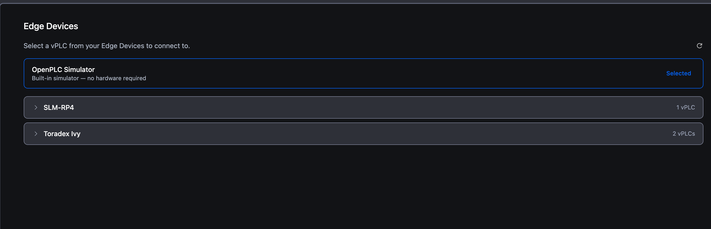
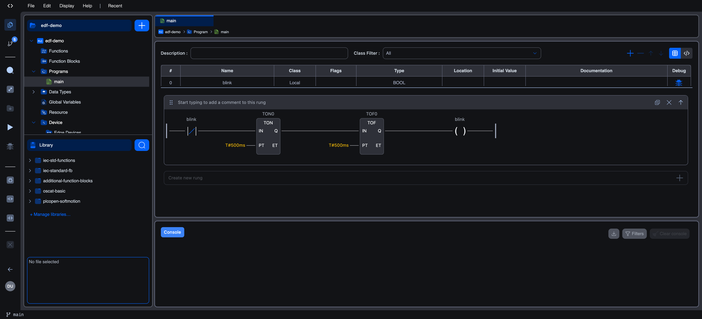
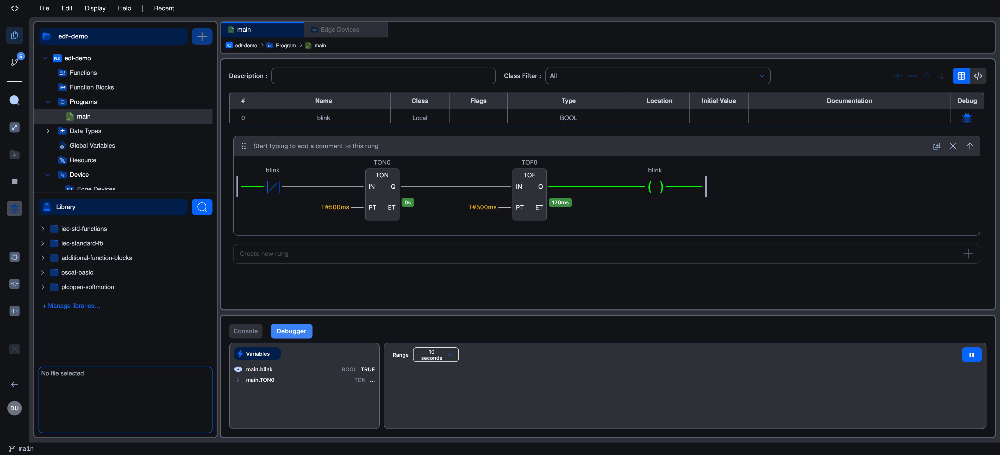
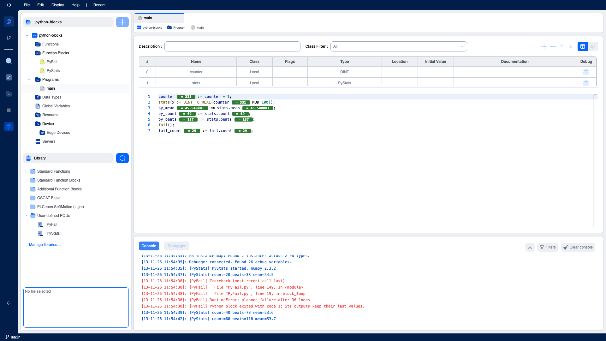

# Running with the Simulator

The editor ships with a built-in **OpenPLC Simulator** that runs your program inside the editor itself: in your browser tab on the web, inside the app on the desktop. The editor compiles the program on your own computer, so there's no hardware to plug in and no server to talk to. Compile, hit **Start Simulator**, and the program is executing in a sandbox under your editor tab.

The Simulator runs programs of realistic size (large arrays included), Python function blocks with threads and numpy, and C/C++ function blocks.

This is the fastest path from "I have an idea" to "let me try it", ideal for learning, prototyping, and quick smoke tests before deploying to a real vPLC.

## Step 1: Make sure the Simulator is selected

The Simulator is the default target. Until you connect to a vPLC on an Edge Device, anything you build runs on the Simulator. You'll see a small simulator icon in the status bar at the very bottom-left of the editor when it's selected.

If you've previously connected to a vPLC and want to switch back:

1. In the project tree, expand **Device** and click **Edge Devices**.
2. The Edge Devices screen opens in a tab.
3. **OpenPLC Simulator** sits at the top with a **Selected** badge. Click anywhere on its card to make sure it's selected.



You don't log in to the Simulator. There's no user account, no IP, no password, it's just there.

## Step 2: Open a POU

Pick any program in the project tree (or create one). For this walkthrough we're going to use the **EDF Demo** project's `main` program, a simple Ladder Diagram blinker that toggles a `BOOL` variable called `blink` once a second using a TON / TOF pair.



The variables table above the body lists `blink` (Local, BOOL). That's all this program needs.

## Step 3: Start the Simulator

Click the **Start Simulator** button in the activity bar, the triangular Play icon, middle of the bar. (When the Simulator is the selected target, the button is labelled "Start Simulator" on hover. When a real vPLC is selected, it reads "Start PLC" instead.)

The editor immediately kicks off a build. The Console tab at the bottom logs each step:

```
[13-11-26 11:54:32]: Build process started
[13-11-26 11:54:32]: Generating Structured Text...
[13-11-26 11:54:32]: Compiling Structured Text to C++ with STruC++...
[13-11-26 11:54:32]: Debug map: 16 leaves in 1 arrays
[13-11-26 11:54:32]: Composing firmware bundle...
[13-11-26 11:54:32]: Compiling the simulator module...
[13-11-26 11:54:34]: Simulator module compiled: 25 files (0 reused) in 2406 ms, linked in 44 ms.
[13-11-26 11:54:35]: Simulator is running.
[13-11-26 11:54:35]: Connecting debugger...
[13-11-26 11:54:35]: Debugger connected. Found 26 debug variables.
```

The first start after opening the editor takes a few seconds for a small project. Later starts are faster, because files you did not change are not compiled again.

If the project doesn't compile, the build stops at the failing step and the console shows the error. Clicking the error jumps to the offending line in the source.

## Step 4: Watch the program run

Once the simulator is up, the bottom panel automatically switches from **Console** to **Debugger**, and your LD or FBD body lights up with **live execution colouring**:

- Green wires carry current.
- Block input/output pins show their current values inline (e.g. a TON's `ET` shows `0s`, `200ms`, `420ms`, etc. as it counts up).
- The contact / coil shape itself doesn't change, but the wires around it tell you whether power is flowing.


The **Debugger panel** at the bottom lists every variable you ticked the **Debug** column for, with their current values updating in real time.

The Play button in the activity bar is now labelled **Stop Simulator**, click it to halt. Clicking it again returns to **Start Simulator** ready for the next run.

## Step 5: Plot variables on the chart

The Debugger has a time-series chart to the right of the variables list:

- Click a monitored variable to add it to the chart.
- The **Range** dropdown picks the visible window (1 s, 5 s, 10 s, 30 s, 1 min, 5 min, or 10 min).
- The pause icon at the top right freezes the chart (polling keeps running; resume to catch up).



For the `blink` program, plot `main.blink` and you'll see it square-wave between FALSE and TRUE every second.

To watch a variable that's not in the list, open the POU's variable table, tick its **Debug** column, save, and the variable appears in the Debugger on the next poll.

## Step 6: Iterate

The simulator hot-swaps cleanly:

1. Make a change to your POU.
2. Click **Stop Simulator**.
3. Click **Start Simulator** again. The editor re-compiles and re-loads the new firmware.

You don't need to close anything in between. The Debugger panel keeps its chart settings.

## What the Simulator can and can't do

**What it can do:**

- Execute any IEC body the compiler accepts: ST, LD, FBD, IL, Python function blocks, C++ function blocks.
- Run programs far larger than a small microcontroller could hold.
- Run timers, counters and edge-triggers on simulated time (see **Time in the Simulator** below).
- Drive the debugger, live-update LD/FBD execution state, and update the variables panel.

**What it can't do:**

- Touch any I/O. The Simulator has no pins. Variables with a location (`%IX0.0`, `%QW0` and the like) behave like ordinary variables: the program and the debugger set them, nothing else does. Pin mapping does not apply to the Simulator.
- Run the Modbus TCP, OPC UA or S7 servers. To test a server, deploy to a vPLC.
- Keep retentive variables. Every start begins from the initial values.
- Persist anything across page reloads. The Simulator's state lives in the editor tab.

If you need I/O, communication servers, or a long-running PLC that survives page reloads, deploy to a vPLC. See **[Connecting to a vPLC](../connecting-to-runtimes)**.

---

## Python function blocks

Python function blocks run in the Simulator the way they run on a Runtime v4 vPLC:

- Each instance of a Python block runs in its own Python 3.13 interpreter, so two instances of the same block never share state.
- The block exchanges its inputs and outputs with the PLC every 100 ms.
- Threads work. A block can start a thread with `threading` and keep it running.
- The standard library and **numpy** are available. numpy is loaded only for blocks that import it.
- Every `print()` line appears on the **Console**, prefixed with the block name, for example `[PyStats] count=20`. Errors appear in red.

When you press **Start Simulator**, the editor prepares one interpreter per Python block while the program starts. The PLC starts once they are ready, so every block runs from the first scan.



**When a block fails.** If a block raises an exception, or fails to import a module, its traceback goes to the Console. The PLC keeps scanning, the block's outputs keep their last values, and the other blocks carry on. The Console then reports `Python block exited with code 1; its outputs keep their last values.`

**A block that never returns.** A block stuck in a loop (`while True: pass`) does not hold up the PLC. **Stop Simulator** ends it at once, along with every other block.

**No network and no hardware.** Python in the Simulator has no network access. A block that opens a socket fails with a traceback on the Console, like any other exception.

> **Warning:** Import numpy at the top of the block's code, not for the first time inside a thread. A block whose first `import numpy` runs inside a thread it started stops responding: it never updates its outputs again. Importing numpy at the top of the block first, as any ordinary Python module does, avoids this.

> **Warning:** On Safari, numpy cannot be loaded. A block that imports numpy stops with an error on the Console, while the PLC and the blocks that don't use numpy run normally. To test a numpy block, use Chrome, Edge or Firefox, or the desktop editor.

---

## C/C++ function blocks

C/C++ function blocks compile against the Arduino API without hardware: `String`, `Print`, `Stream` and the rest of the core classes are there, but no board. Code guarded with `#ifdef ARDUINO` is compiled.

- Pin functions exist and do nothing: `digitalWrite()` and `analogWrite()` have no effect, `digitalRead()` returns `LOW` and `analogRead()` returns `0`.
- `delay()` returns at once, because simulated time only moves between scans. `millis()` and `micros()` follow simulated time.
- `Wire`, `SPI` and `EEPROM` are not available. A block that uses them fails with a compile error.
- Don't write to `Serial`: in the Simulator it carries the debugger's connection, and anything a block prints there can disturb the debugger.
- Code written for a specific microcontroller does not compile for the Simulator. Registers such as `PORTB`, and headers such as `avr/io.h`, fail with a normal compile error on the Console.
- An `int` is 32 bits wide in the Simulator. Code that relies on a 16-bit `int`, as on 8-bit Arduino boards, can behave differently. Use fixed-width types such as `int16_t` when the width matters.

---

## Time in the Simulator

Simulated time advances by the task interval on every scan. On a `T#20ms` task, a `TON` with `PT := T#1s` fires after exactly 50 scans.

The Simulator follows the clock on the wall whenever it can and never runs faster than it. It can fall behind, for example while the browser tab is hidden. It does not catch up by running scans faster afterwards. Real-time guarantees are not part of the Simulator: for timing-sensitive tests, use a vPLC.

Python blocks run on the clock on the wall. If the Simulator falls behind, Python's time and the PLC's time drift apart.

---

## Behind the scenes

When you press **Start Simulator**, the editor:

1. Compiles your project through the **STruC++** pipeline (same path as for a real runtime).
2. Compiles the result, together with a reduced OpenPLC runtime, into a program the editor runs itself. Nothing is sent to a server.
3. Prepares one Python interpreter per Python block instance.
4. Starts the program and connects the debugger to it.

Stopping halts the program and every Python block. Starting again re-runs the build, reusing what did not change.

The compiler and Python are part of the editor. They load while the editor's loading screen is up, so the Simulator is ready the moment the editor is. On the web, the first visit downloads them once; later visits load them from the browser's cache until the next editor version.

---

## Troubleshooting

**The build fails with a syntax error.** Click the error in the console to jump to the source line. The Simulator never tries to load a broken build.

**The editor says it could not start.** The editor loads its compiler and Python while the loading screen is up, and it does not open if one of them fails to load. On the desktop, reinstall the editor. On the web, reload the page.

**A Python block prints nothing.** Open the **Console** tab: the bottom panel switches to the **Debugger** when the Simulator starts. If the Console shows a traceback for that block, the block stopped; fix the code and start again.

**A C/C++ block that built for the old Simulator no longer compiles.** It most likely uses code written for a specific microcontroller (`PORTB` and similar). See **C/C++ function blocks** above.

**The Simulator starts but the LD body doesn't colour.** The Debugger needs at least one variable opted in (the **Debug** column in the variable table). Tick the relevant variables and re-save, the live colouring kicks in immediately.

**The chart stays empty.** Click the variable name in the Debugger's variables list to add it to the chart. Boolean variables plot as sharp 0/1 transitions; numeric variables share a normalised Y axis with whatever else is on the chart.

**The Simulator runs forever after I close my tab.** It doesn't. The Simulator lives in your editor tab; closing the tab stops it. A real vPLC keeps running after you disconnect, the Simulator does not.

## What's next

- **[Connecting to a vPLC](../connecting-to-runtimes)**: when you're ready to run on a real device, or on a vPLC hosted by an Edge Device.
- **[Debugger](debugger)**: the full reference for the live-variable chart and how variables get included.
- **[Project compilation](project-compilation)**: what each step of the build pipeline does.
