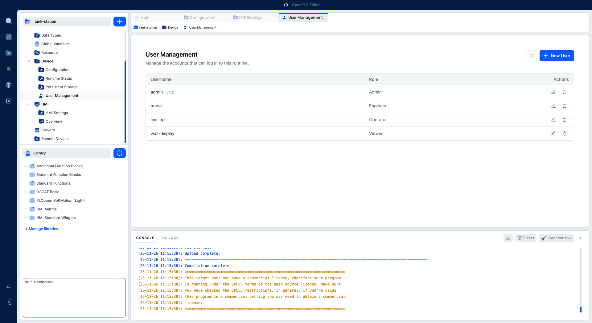
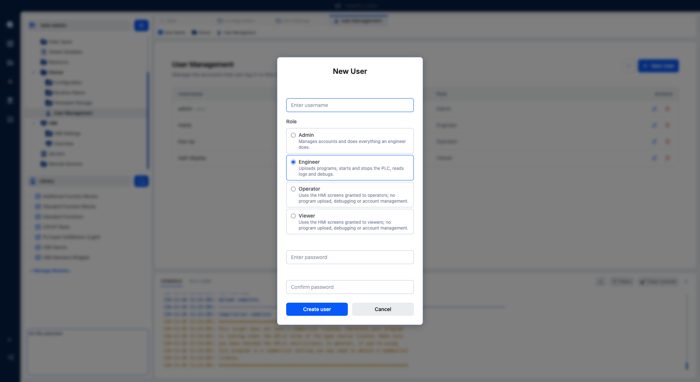

# User management

Every OpenPLC runtime keeps its own list of accounts. Signing in to a device is what lets the editor upload to it, start and stop it, watch variables and read its logs, and what lets operators open its HMI screens. Those accounts are the device's access control, not the platform's.

**User Management** is where you manage them. It lives under the **Device** branch of the project tree, and unlike most of what is in that tree it configures the **connected device** rather than the project.

Accounts belong to the device. They do not travel with the project, and two people working on the same project against different PLCs are administering two separate lists. Your Autonomy Edge account is a different thing entirely: it gets you into the platform and the editor, not into any particular PLC.

## When the screen appears

The leaf is in the tree when you are **connected to a device** running **runtime 4.1.9 or newer**. Older runtimes predate the account roles this screen manages.

Opening it without a connection shows: *"You are not connected to a runtime. Connect to the runtime to manage its users."*

## The first account

A brand-new runtime has no accounts, and until it has one anybody on the network could claim it. So the first time you connect to an empty device, the editor asks you to create an account instead of asking you to sign in.

**That first account is always an administrator**, whatever you pick afterwards. The device would otherwise have no one able to create the second account.

## The four roles

From runtime 4.4.0, accounts have one of four roles. Two are for the people who build and maintain the program, two are for the people who run the machine through its [HMI](../hmi/overview).

| | **Admin** | **Engineer** | **Operator** | **Viewer** |
|---|---|---|---|---|
| Sign in to the device | Yes | Yes | Yes | Yes |
| Open HMI screens | All | Those granted to engineers | Those granted to operators | Those granted to viewers |
| Upload a program | Yes | Yes | No | No |
| Start and stop the PLC | Yes | Yes | No | No |
| Read the status | Yes | Yes | Yes | Yes |
| Read the logs | Yes | Yes | No | No |
| Debug and force variables | Yes | Yes | No | No |
| View the account list | Yes | Yes | No | No |
| Create and delete accounts, change other accounts and roles | Yes | No | No | No |
| Change **its own** password | Yes | Yes | Yes | Yes |
| Change **its own** name | Yes | Yes | No | No |
| [Retrieve the project stored on the device](retrieve-project) | Yes | No | No | No |

Which HMI screens each role may open is set per screen in [HMI Settings](../hmi/hmi-settings). On the screens it may open, a role can use every control the screen offers.

Accounts that existed before 4.4.0 with the role *User* become **Engineers**, with the same rights they had.

> **Tip:** Give each person their own account with the lowest role that does the job. A wall display that only shows values gets a Viewer account; the person who acknowledges alarms gets an Operator account.

## The screen

The table lists every account on the device with its role. Your own account is marked **(you)**. Each row has a pencil to edit the account and a bin to delete it.

The device decides what your role may do. When it refuses an action, the screen says why, for example *Your role (engineer) can't create accounts*.

An Operator or a Viewer cannot see the account list. For them the screen shows only their own account, with a notice, so they can still change their password.

## Creating an account

Click **+ New User**.

Fill in the username, pick the **Role**, and enter the password twice. **The role defaults to Engineer.** Usernames must be unique on the device.

Only an administrator can create accounts.

## Editing an account

Click the pencil. **Your own account** opens as *"Edit your account"*; someone else's as *"Edit user"* with its name.

The password fields start filled with a masked placeholder so the form looks populated without holding a real password. Nothing is submitted until you actually type in them.

**Changing your own password asks for your current one.** The extra field appears as soon as you start typing a new password. This is what stops someone who has walked up to an unlocked session from silently taking the account over.

Changing your own password keeps the editor connected: it signs in again with the new password by itself. Your other sessions on the device, such as an HMI display signed in with the same account, end and have to sign in again.

**Someone else's account** can be given a new password without their current one, which is what lets an administrator reset a forgotten password. Changing an account's password, role or name, or deleting it, ends every session of that account on the device.

If your own account is changed or deleted from somewhere else while you are connected, the editor picks up the new role the next time it signs in, or disconnects and tells you that the device refused to sign you in again because your account was deleted or its password was changed.

### The last administrator is protected

A device must keep at least one administrator, so the runtime refuses to demote the only one, answering *"Cannot demote the last remaining admin"*. Promote a second administrator first, then demote the original. An administrator also cannot change their own role or delete their own account: another administrator has to do it.

## Deleting an account

Click the bin and confirm. Only an administrator can delete accounts, and never their own.

Deleting an account does not disturb the running program. It only removes that account's ability to sign in, and signs it out everywhere.

## Signed in as an Operator or a Viewer

When you connect the editor with an Operator or Viewer account, the editor still opens the project and shows the device's status, but the actions the role may not use are disabled. Hovering one says why, for example *Your role (operator) can't upload programs*. **Build only** stays available, since it does not touch the device.

## Older runtimes

On a runtime older than 4.4.0, the screen works the same way, with two roles only: **Admin** and **Engineer** (the runtime's *User*). The role choices offer only those two.

## Related

- **[Connecting to runtimes](../connecting-to-runtimes)** for signing in and what a device session is.
- **[Running the HMI](../hmi/running-the-hmi)** for what each role sees in the HMI.
- **[Runtime status](runtime-status)**, the other device-scoped screen, for what the device is and how it is running.
- **[Persistent storage](persistent-storage)**, which sits beside this screen in the tree but is a project setting rather than a device one.
- **[Retrieve a project from a PLC](retrieve-project)**, which requires an administrator account on the device.
