# Modbus remote device (master)

When you want your PLC to **read** from or **write** to a remote Modbus slave, a field-level sensor, a meter, a VFD, an external PLC, a Modbus-RTU gateway, configure a **Modbus remote device**. The PLC becomes the master; the remote is the slave. The PLC can be a vPLC running OpenPLC Runtime v4 or a microcontroller board (an Arduino, an ESP32 or another board from a board package).

This lives under **Remote Devices** in the project tree, not under **Servers** (that's the *slave*-side configuration covered on the **[Modbus server](server)** page).

## Add a remote device

1. Click the **`+`** button at the top of the project tree.
2. Pick **Remote Device** in the popover.
3. The dialog asks for a device name and a protocol. Pick **Modbus** from the dropdown.

   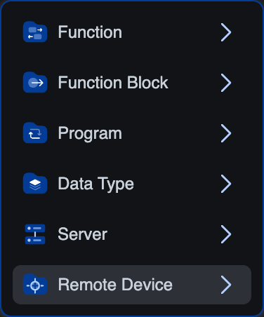 *(EtherNet/IP and PROFINET are visible but greyed out, they're not supported on this build yet)*

4. Name it (e.g. `flow_meter_1`) and click **Create**.

The new entry appears under **Remote Devices** in the tree. Click it to open the configuration editor.

> **Which targets run remote devices.** Runtime v4 runs them over TCP and RTU. A microcontroller board runs them over TCP when its board package enables the TCP master (the official packages do so on every board with a network), and over RTU when it has a UART besides the one the editor's debugger uses (see [On a microcontroller board](#on-a-microcontroller-board)). The Simulator lists remote devices but does not run them, and Runtime v3 ignores them: both show a warning at build time and the build goes on.

> **Warning:** Modbus has no authentication and no encryption. Any host on the same network or RS-485 bus can read the values, send forged answers or take over a slave's address. Keep the PLC, its Modbus slaves and the RS-485 bus on a segregated network that you control, never on the office network and never reachable from the internet.

## The editor at a glance

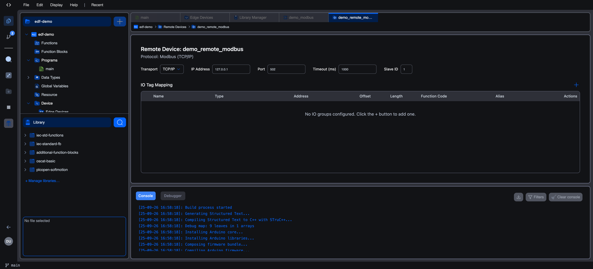

The top row is the **transport** (how the editor reaches the slave on the wire). Below is the **IO Tag Mapping** table, your I/O Groups and the points within them.

## Transport configuration

A single dropdown selects **TCP/IP** or **Serial (RTU)**.

### TCP/IP transport

| Field | Default | Notes |
|---|---|---|
| **IP Address** | `127.0.0.1` | IP or hostname of the remote slave. Reachable from the runtime's network. On a microcontroller board, use an IP address: a hostname is refused when you build. |
| **Port** | `502` | TCP port. Most slaves listen on 502; gateway hardware sometimes uses 1502 or 5020. |
| **Slave ID** (Unit ID) | `1` | Range `0…255` for TCP. Most native TCP slaves accept any ID; gateways use it to route to RS-485 sub-devices. |
| **Timeout (ms)** | `1000` | How long to wait for a response before counting the cycle as failed. Increase for slow slaves or congested networks. On a microcontroller board, each connection attempt can hold the scan for up to this time. |
| **Reconnect** | unchecked for a new device | What the master does when the connection fails or drops. See [Reconnect](#reconnect) below. |

### Serial (RTU) transport

Switch the Transport dropdown to **Serial**. The fields change to:

| Field | Default | Notes |
|---|---|---|
| **Serial port** | first available | On a vPLC, the serial ports the runtime can see (USB serial adapters, mapped serial ports). On a microcontroller board, the board's UARTs except the one the editor's debugger uses. |
| **Baud rate** | `9600` | Pick from `9600 / 19200 / 38400 / 57600 / 115200`. Match the slave's setting. |
| **Parity** | `N` (none) | `N`one / `E`ven / `O`dd. |
| **Stop bits** | `1` | `1` or `2`. |
| **Data bits** | `8` | `7` or `8`. |
| **Slave ID** | `1` | RTU range is `1…247` (not 0). |
| **Timeout (ms)** | `1000` | Same meaning as TCP. RTU slaves typically need more time per turnaround. |

The single most common cause of "no RTU response" is a single mismatched parity / stop bit, they fail silently and the master just times out. Cross-check against the slave's data sheet.

All devices on one serial port share the bus, so they must use the same baud rate, parity, stop bits and data bits. When several devices share a serial port, or a TCP device shares an IP address and port with another, the shortest **Timeout** among them applies to all of them.

---

## Reconnect

**Reconnect** is a checkbox on TCP devices. It decides what the master does when the first connection to the device fails, or when an open connection is lost (the network reports the connection closed, reset or failing).

- **Checked:** the master keeps trying. It waits 2 s before the next attempt, then 1.5 times longer after each failed attempt, up to 30 s between attempts.
- **Unchecked:** the master gives the device up. It does not contact the device again until you **Stop** then **Start** the PLC from the editor, or reset or power cycle the controller.

The help text under the checkbox says the same thing on every target.

> **Warning:** With Reconnect unchecked, any brief network fault that drops the connection is enough to lose the device until the next Stop then Start or reset, and so is a reset sent by another host on the network. Check **Reconnect** for production devices.

Good to know:

- A new TCP device starts with Reconnect unchecked. A TCP device from a project saved before the option existed opens with Reconnect checked, so it keeps retrying as before.
- A failed poll never gives a device up. An exception answer, an answer that does not match the request, or no answer within the timeout counts as one failed poll, and the next poll goes out on the group's cycle.
- Devices that share one IP address and port share one connection, so they must have the same Reconnect setting. Otherwise the build is refused.
- While a device is failing or given up, its read groups follow their **Error Handling** (keep the last value or set to zero) and its write groups send nothing.
- On Runtime v4 with Reconnect checked, the runtime also closes and reopens the connection after a failed poll. On a microcontroller board the connection stays open after a failed poll, whatever the Reconnect setting.
- A Runtime v4 installed before this option existed ignores it and keeps retrying, even when the box is unchecked.

---

## On a microcontroller board

The Remote Device screen is the same on a microcontroller board as on a vPLC. The board limits what the screen offers:

- **TCP/IP** is offered when the board's package enables the TCP master. The official packages do so on every board with a network (Ethernet, Wi-Fi or an Ethernet shield).
- **RTU (Serial)** is offered when the board has a UART besides the one the editor's debugger uses. A board with a single UART (Arduino Uno, Nano, Uno Q) offers TCP only.
- The **Serial Port** list shows the board's UARTs without the debugger's one. On an Arduino Mega, that is **Serial1**, **Serial2** and **Serial3**.

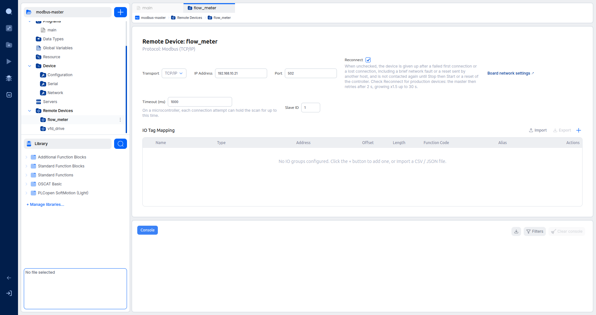

A TCP device shows a **Board network settings** link, and an RTU device shows a **Board serial settings** link. Each opens the board's **Network** or **Serial** page, where you set the network the board connects to and the RS-485 pin of each UART.

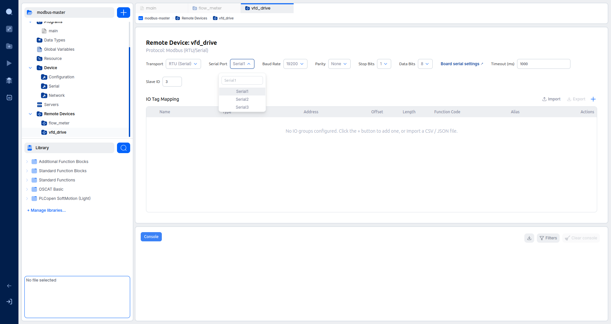

How the master runs on a microcontroller:

- It polls each I/O group on its cycle time, for function codes 1, 2, 3, 4, 5, 6, 15 and 16, and splits a group too large for one frame into several requests.
- Devices on the same IP address and port share one connection, and devices on the same UART share one bus.
- The master waits until the board reports its network connection up before it connects to a TCP device. A connection that fails while the board is off its network does not count against the device, even with Reconnect unchecked.
- When you **Stop** the PLC, the master closes its connections and stays idle. **Start** runs it again from scratch, so a device it gave up on is tried again.
- An RTU slave that does not answer keeps being polled on its cycle, which delays the other slaves on the same bus.

### Known limits on ESP32 and ESP8266 Wi-Fi boards

- **The board does not rejoin Wi-Fi on its own.** The firmware relies on the board's Wi-Fi driver to rejoin the network after an outage. If the board stays off the network after your access point is back, the Modbus master keeps waiting for the network and polls nothing. Press the board's reset button or power cycle the board.
- **After a USB upload, an ESP32 on Wi-Fi may not connect to its TCP devices.** The board joins the network and answers ping, but the master never opens its connections. Press the board's **EN** (reset) button or power cycle the board, and the master connects.

> **Tip:** After you upload a program to an ESP32 on Wi-Fi, press **EN** once before you check the Modbus values in the debugger.

### RS-485 on a microcontroller board

An RS-485 transceiver needs a pin that switches it between transmit and receive. You set that pin per UART, on the board's **Serial** page (in the project tree, **Device** > **Serial**, or through **Board serial settings**), in the **RS-485 EN Pin** field of that UART. The Remote Device screen has no RS-485 setting.

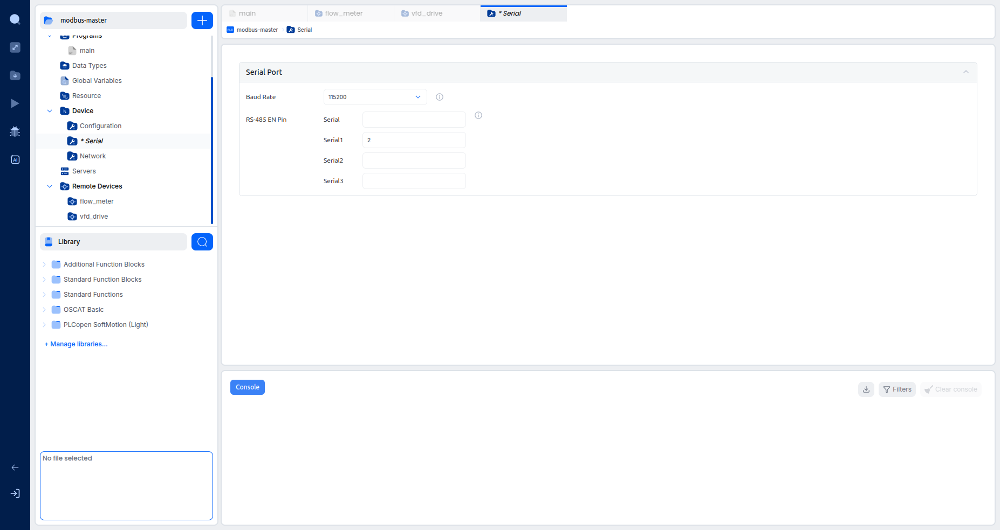

- **Bare boards** (an Arduino or an ESP32 wired to an external transceiver module): wire the transceiver's DE and RE pins together to a free GPIO, then enter that GPIO in the RS-485 EN Pin field of the UART the transceiver is on. The firmware drives the pin high while it transmits and low while it listens. Leave the field empty for a UART with no transceiver, or with a transceiver that switches direction by itself.
- **Controllers with built-in RS-485:** the board package fixes the pin. The Serial page shows no field for that UART, and the fixed pin is used when you build.

A pin is a pin number or a port-pin name: up to two capital letters followed by one to three digits, such as `2`, `A0` or `PA14`. The Serial page shows an error under the fields and does not save a value that does not match.

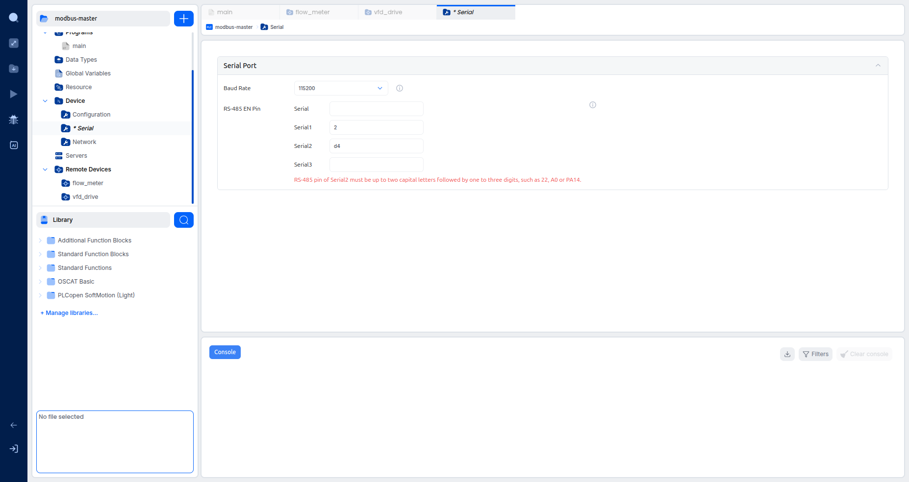

**Projects from an older editor.** Older projects have a single RS-485 pin for the whole board. When the board's package takes one pin per UART, that pin moves to the UART your Modbus RTU server uses. If the project has no Modbus RTU server, the old pin stays in the project but is not shown on any UART and is not used when you build. Set the pin on the right UART: the first pin you set replaces the old one. If you add an RTU device behind an RS-485 transceiver, check that its UART has a pin.

---

## Build checks

The editor checks the remote devices before it compiles. When a check fails, the console names the device and the build stops before compiling.

| Check | Runtime v4 | Microcontroller | Simulator |
|---|---|---|---|
| TCP devices on one IP address and port have the same Reconnect setting | Yes | Yes | Yes |
| RTU devices on one serial port have the same baud rate, parity, stop bits and data bits | Yes | Yes | Yes |
| The target can run the device's transport (`Remote device "x" does not support TCP`) | Yes | Yes | No |
| A TCP device's host is an IP address | No | Yes | No |
| TCP devices have the network enabled on the board's **Network** page | No | Yes | No |
| An RTU device does not use the debugger's UART or the Modbus RTU server's UART | No | Yes | No |
| Every field is in range, and every RS-485 pin is a valid pin name | No | Yes | No |

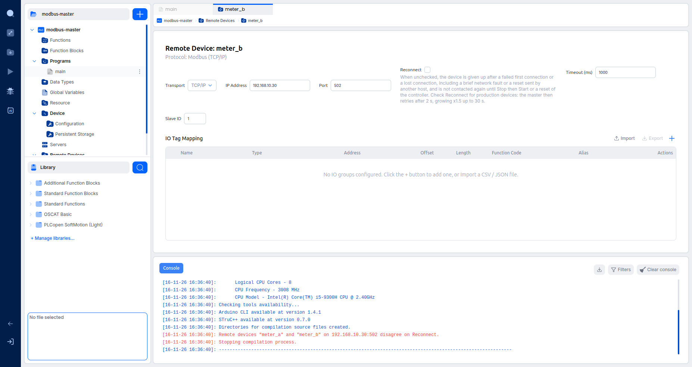

On a microcontroller board, the build also warns, without stopping, when the project uses more TCP endpoints (distinct IP address and port pairs) than the network sockets the board's package declares. On the board, a connection that finds no free socket counts as a failed connection, and Reconnect applies.

If you switch the project to a board that cannot run one of its devices, the editor tells you so. The device stays in the project, and the build is refused until you fix it or remove it.

---

## I/O Groups

An **I/O Group** is one polled Modbus operation against the remote: one function code, one address range on the remote, one polling cycle. A remote device usually has several groups, one for reading temperatures, one for reading pressures, one for writing setpoints, etc.

### Adding a group

Click the **`+`** in the IO Tag Mapping section's top-right. The **New IO Group** modal opens.

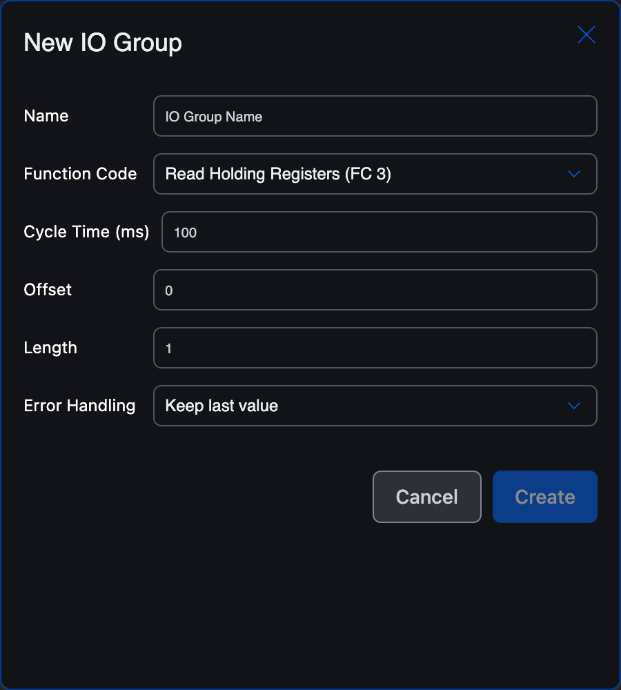

Field by field:

| Field | Notes |
|---|---|
| **Name** | Your label. The points inside the group are auto-named `<name>_0`, `<name>_1`, …, but you can rename them later. |
| **Function Code** | Pick one of the 6 supported codes (see below). Determines whether this group reads or writes, and what kind of memory it targets. |
| **Cycle Time (ms)** | How often the master issues this request. `100` is a reasonable default; `1000` is gentler on slow slaves. The runtime pipelines all groups; cycles don't need to be aligned. |
| **Offset** | The Modbus address on the **remote** where this read/write starts. The remote's address space, not yours. |
| **Length** | How many addresses to read/write per cycle. The runtime creates `Length` I/O points within the group. |
| **Error Handling** | What to do with the local mirror if a cycle fails: `Keep last value` (leave the local image untouched) or `Set to zero` (clear the mirror). Use `Keep last value` for HMIs that show last-known-good; use `Set to zero` for safety logic that should default-fail. |

### Function codes

The modal's Function Code dropdown lists six options:

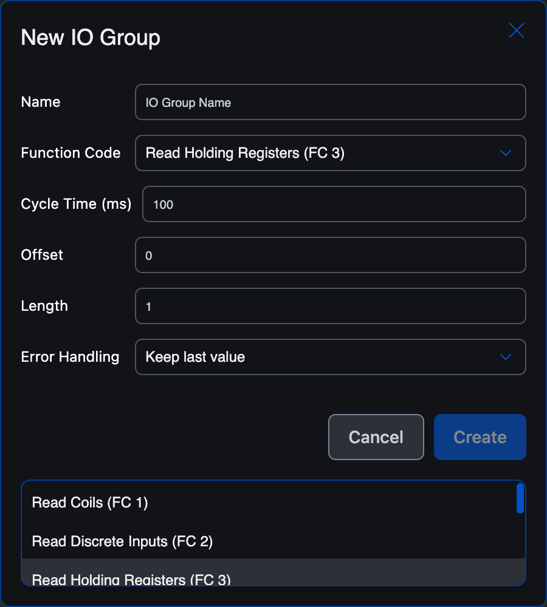

| FC | Direction | Reads / Writes | Use when |
|---|---|---|---|
| **FC 1** Read Coils | Read | Bits | Polling on/off statuses (alarms, switch positions, control bits) from a remote |
| **FC 2** Read Discrete Inputs | Read | Bits, read-only | Polling sensor states the remote exposes as read-only (limit switches, photoelectric flags) |
| **FC 3** Read Holding Registers | Read | 16-bit | Polling integer/scaled-real values (temperatures, pressures, setpoint readbacks), **most common** |
| **FC 4** Read Input Registers | Read | 16-bit, read-only | Polling sensor analogs the remote exposes as read-only |
| **FC 5** Write Single Coil | Write | One bit per cycle | Toggling a single output (start/stop bit) |
| **FC 6** Write Single Register | Write | One 16-bit per cycle | Writing a setpoint or command word |

For **block writes** (Write Multiple Coils / Write Multiple Registers, FC 15 / FC 16), use multiple write groups, or stage values to a holding-register block on the remote that it then atomically applies.

### Worked example, polling a single holding register

A flow meter exposes its current reading at holding register `0` of slave ID `7` over Modbus RTU. Configure:

- **Transport**: Serial, with the meter's baud / parity settings.
- **Slave ID**: `7`.
- **New IO Group**: Name `flow`, Function Code `Read Holding Registers (FC 3)`, Cycle Time `500` ms, Offset `0`, Length `1`, Error Handling `Set to zero`.

Click **Create**. The group appears in the IO Tag Mapping table:

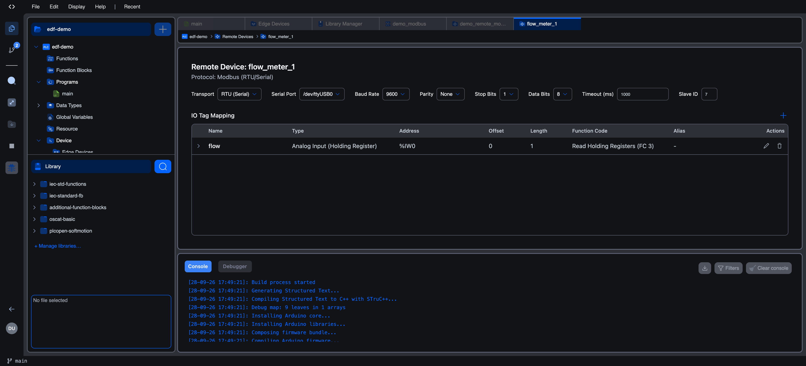

### Expanding a group to see its points

Click the chevron at the start of the group row to expand it. Each point inside the group gets its own row.

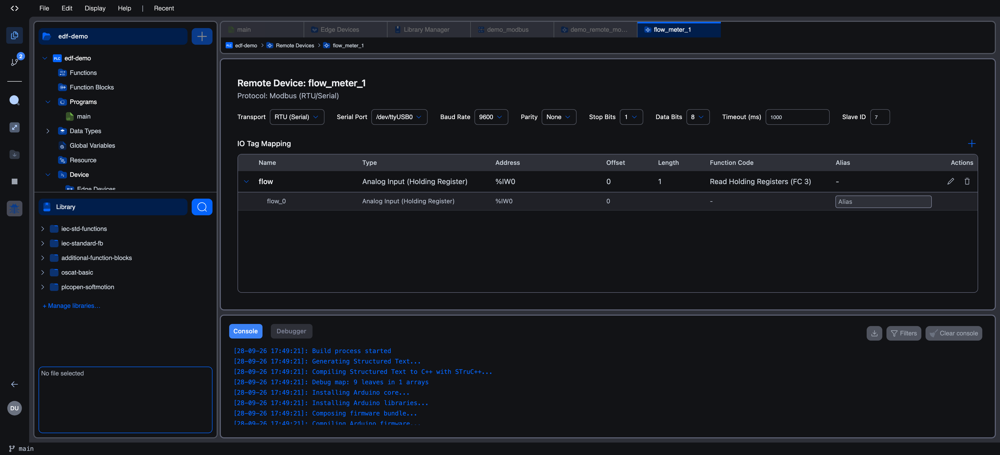

Per-point columns:

- **Name**: auto-generated as `<group>_<index>`. Rename to something meaningful.
- **Type**: derived from the group's function code. You typically don't edit this directly.
- **Address**: the **local IEC address** the remote value is mirrored into (or pulled from for writes). For an FC 3 group, the master writes incoming values into `%IW<n>` slots starting from offset 0.
- **Offset**: the per-point offset inside the group. For `Length=1` you only have offset 0.
- **Function Code**: only meaningful at the group level for reads/writes; per-point shown as `-`.
- **Alias**: your stable name for the point. Use this in your program instead of the bare IEC address.

### Setting an alias

Click the Alias field on a point row and type a name. Tab out to save.


Once you've set an alias, you can reference the variable in your program by alias, and if you later reorganise the group (insert points, change offsets), the variable's local `Location` follows the alias automatically. Without an alias, your program references the raw IEC address (`%IW0`), and if the address moves you have to track down every reference by hand.

This is the **producer-managed addressing** pattern, see **[Variables editor → Aliases](../../working-with-variables/variables-editor#aliases-producer-managed-addresses)** for the full mechanism.

## Multiple groups, mixed function codes

A typical remote-device configuration has several groups:

```
flow_meter:
  Group "readings"   FC 3 cycle 500ms  offset 0  length 8   → 8 holding registers
  Group "alarms"     FC 1 cycle 200ms  offset 100 length 16 → 16 coils
  Group "setpoint"   FC 6 cycle 1000ms offset 200 length 1  → write single register
```

Each group polls or pushes on its own cycle. The runtime serialises them, at any moment one request is in flight, with the others queued. Cycle times are a hint, not a hard guarantee; under load, slow cycles can be pushed back. If you're hitting timing trouble, raise cycle times rather than trying to align them precisely.

## How values land in your program

After the runtime starts, your program just reads the local mirror, either by the IEC address (`%IW0`) or by the alias you set (recommended). For read groups, the mirror is updated each cycle from the remote. For write groups, your program writes to the local address and the runtime ships the value to the remote at the next cycle.

This means your program treats remote I/O exactly the same as local I/O, same variables editor, same execution model. The Modbus master is invisible at the IEC level.

## Diagnostics

On Runtime v4, the **PLC Logs** tab (visible when connected to a vPLC) prints per-cycle failures, the slave's exception codes, and a message when the master gives a device up.

A microcontroller board keeps no log and publishes no device status. To know in your program whether a slave is answering, wire an **echo point**:

1. In your program, keep a counter that changes every few cycles and never reaches zero.
2. Add a write group that writes the counter to a spare holding register on the slave (Write Single Register, FC 6).
3. Add a read group that reads the same register back (Read Holding Registers, FC 3), with **Error Handling** set to `Set to zero`.
4. In your program, compare the value read back with the counter. When the value read back stops following the counter, or falls to zero, the device is not answering. Use that bit for your alarms and interlocks.

If the slave already has a value that changes while it is healthy, such as a heartbeat counter, a read group on that value with `Set to zero` works the same way.

## Troubleshooting

**No Modbus in the Remote Device protocol list.** The active target cannot run a Modbus master: it has no network declared and no UART besides the debugger's. Use Runtime v4, or a board with a network or a second UART.

**A TCP device stopped and never came back.** Its Reconnect box is unchecked, and the connection failed or dropped once. **Stop** then **Start** the PLC to try it again, and check **Reconnect** for that device.

**An ESP32 or ESP8266 on Wi-Fi polls nothing after an upload or a Wi-Fi outage.** Reset or power cycle the board. See [Known limits on ESP32 and ESP8266 Wi-Fi boards](#known-limits-on-esp32-and-esp8266-wi-fi-boards).

**TCP timeouts.** Host or port unreachable. From a shell on the Edge Device: `telnet <ip> 502` should connect. Check firewalls, NAT, and that you're using the right port.

**RTU never responds.** Match the serial parameters exactly, baud, parity, stop bits, data bits. A single mismatched bit silently drops every frame. On a microcontroller board with an RS-485 transceiver, check that the UART has the right **RS-485 EN Pin** on the board's **Serial** page.

**Reading wrong values.** Modbus tools differ in coil/register numbering (some 1-based, some 0-based). The IEC address you bind is the *wire* address, coil 0, holding register 0. If your HMI shows "coil 1" for the same point, that's its display offset, not the wire address.

**Cycle time looks ignored.** Under load, the master queues. If cycle = 100 ms but a single round-trip is 200 ms because of a slow slave, you'll see ~200 ms intervals. Either accept the actual rate or move slow groups to a longer cycle so the fast ones don't queue behind them.

## What's next

- **[Modbus addressing](addressing)**: coil 8 vs. `%QX1.0`, holding-register layout.
- **[Modbus server](server)**: the slave side, hosted on this vPLC.
- **[Variables editor → Aliases](../../working-with-variables/variables-editor)**: how alias-tracked variables keep their bindings as groups change.
