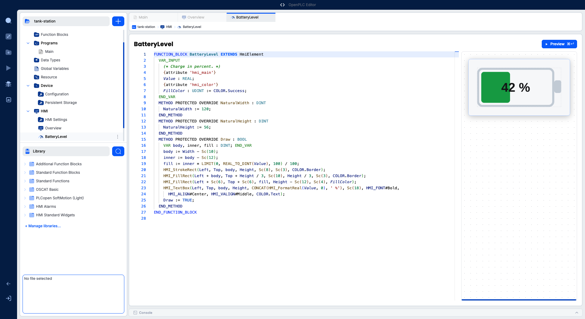
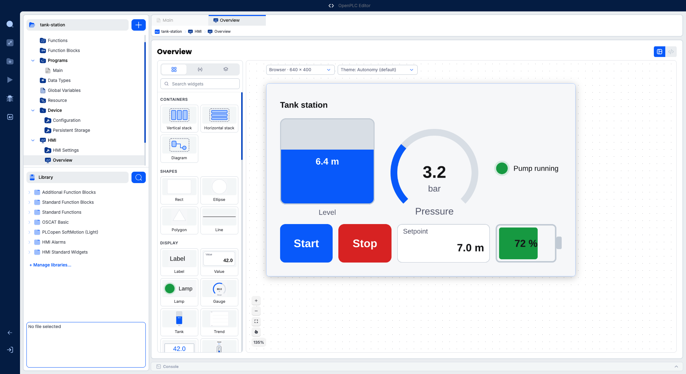
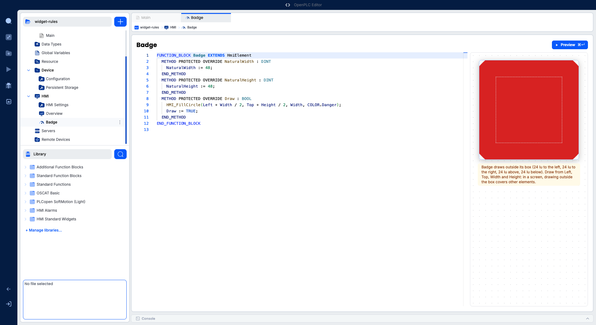

# Creating widgets

When the library does not have the widget you need, write your own. A **widget block** is a function block in Structured Text that draws itself in the box its container gives it. Once written, it appears in the palette and is used like any library widget: dropped on screens, bound to variables, sized by Span.

This page builds a battery level widget step by step. The [Widget reference](widget-reference) lists everything a widget block can use.

---

## Create the widget block

Click **+** at the top of the project tree and choose **HMI Widget**. Name it `BatteryLevel`. It opens in its own tab, with the code on the left and a preview on the right, and starts as a working example (a dot that lights up):

```st
FUNCTION_BLOCK BatteryLevel EXTENDS HmiElement
  VAR_INPUT
    {attribute 'hmi_main'}
    Value : BOOL;
  END_VAR
  METHOD PROTECTED OVERRIDE NaturalWidth : DINT
    NaturalWidth := 48;
  END_METHOD
  METHOD PROTECTED OVERRIDE NaturalHeight : DINT
    NaturalHeight := 48;
  END_METHOD
  METHOD PROTECTED OVERRIDE Draw : BOOL
    HMI_FillCircle(CenterX(), CenterY(), MIN(Width, Height) / 2, SEL(Value, COLOR.Border, COLOR.Success));
    Draw := TRUE;
  END_METHOD
END_FUNCTION_BLOCK
```

Every widget block has the same shape:

- `EXTENDS HmiElement` makes it a widget. (It can also extend another widget, to build on it.)
- **Inputs** (`VAR_INPUT`) are its properties. They appear on the widget's properties card.
- **NaturalWidth** and **NaturalHeight** say how big it would like to be.
- **Draw** draws it.

---

## The box

You never choose where your widget is or how big it is. The container decides, and your widget reads the result in four values:

| Value | Meaning |
|---|---|
| `Left`, `Top` | The top-left corner of the widget's box. |
| `Width`, `Height` | The size of the box. |

Draw only inside that box, with every position and length taken from these four values. That is what lets the same widget fill a large tile on a monitor and a small one on a 320 by 240 panel.

`NaturalWidth` and `NaturalHeight` are only a wish: the size the widget gets when nothing else decides, and the size the designer starts from when you drop it. The box can end up larger or smaller.

Two helpers keep the inside of your drawing in proportion:

- `Sc(n)` scales a length you designed at natural size to the size the widget really has. A 3 unit border stays a thin border on a small widget and a thicker one on a large widget. Use it for border widths, corner radii, margins and text sizes.
- `CenterX()` and `CenterY()` give the center of the box.

---

## Write the widget

Replace the example with the battery widget:

```st
FUNCTION_BLOCK BatteryLevel EXTENDS HmiElement
  VAR_INPUT
    (* Charge in percent. *)
    {attribute 'hmi_main'}
    Value : REAL;
    {attribute 'hmi_color'}
    FillColor : UDINT := COLOR.Success;
  END_VAR
  METHOD PROTECTED OVERRIDE NaturalWidth : DINT
    NaturalWidth := 120;
  END_METHOD
  METHOD PROTECTED OVERRIDE NaturalHeight : DINT
    NaturalHeight := 56;
  END_METHOD
  METHOD PROTECTED OVERRIDE Draw : BOOL
    VAR body, inner, fill : DINT; END_VAR
    body := Width - Sc(10);
    inner := body - Sc(12);
    fill := inner * LIMIT(0, REAL_TO_DINT(Value), 100) / 100;
    HMI_StrokeRect(Left, Top, body, Height, Sc(8), Sc(3), COLOR.Border);
    HMI_FillRect(Left + body, Top + Height / 3, Sc(10), Height / 3, Sc(3), COLOR.Border);
    HMI_FillRect(Left + Sc(6), Top + Sc(6), fill, Height - Sc(12), Sc(4), FillColor);
    HMI_TextBox(Left, Top, body, Height, CONCAT(HMI_FormatReal(Value, 0), ' %'), Sc(18), HMI_FONT#Bold,
      HMI_ALIGN#Center, HMI_VALIGN#Middle, COLOR.Text);
    Draw := TRUE;
  END_METHOD
END_FUNCTION_BLOCK
```

What each part does:

- `{attribute 'hmi_main'}` marks **Value** as the widget's main value: dropping a variable on the widget binds it to Value.
- `{attribute 'hmi_color'}` makes **FillColor** a color picker on the properties card.
- The body of the battery is the box minus a small terminal on the right (`body := Width - Sc(10)`).
- The outline, terminal, fill and text are all placed from `Left`, `Top`, `Width` and `Height`, with `Sc()` for the fixed lengths.

Press **Preview** (or **Ctrl+Enter**, **Cmd+Enter** on macOS) to build it.



The preview draws the widget once at its natural size. The dashed outline is its box. The preview shows a test value (42 here) so you see the widget working.

---

## Use it on a screen

Your widget is now in the palette of every screen, under **Project widgets**. Drop it like any other widget, then drag a REAL variable onto it.



It follows the layout like the library widgets: change its Span or the display size and it redraws at the new size.

---

## Two rules the editor checks

### Positions and lengths must come from the box

A drawing call with a fixed number as a position or a length cannot follow the box, so it fails the build. The code view marks the argument:


Write `HMI_FillRect(Left, Top, Width, Height, ...)` instead, and `Sc(20)` for a length that must look like 20 at natural size.

### Drawing must stay inside the box

A widget that draws past its box would cover its neighbours on a screen. The preview measures what the widget draws and warns when it reaches past the box:



Here the circle's radius is `Width` instead of `Width / 2`. The warning says on which sides and by how much, so the fix is usually obvious.

---

## Making a widget interactive

A widget can react to touch and report it, so screens can act on it. For example, a tile that reports a press:

```st
FUNCTION_BLOCK PressTile EXTENDS HmiElement
  VAR_INPUT
    Text : STRING(32) := 'Press';
  END_VAR
  VAR_OUTPUT
    Pressed : BOOL;
    Clicked : BOOL;
  END_VAR
  METHOD PROTECTED OVERRIDE TakesInput : BOOL
    TakesInput := TRUE;
  END_METHOD
  METHOD PROTECTED OVERRIDE NaturalWidth : DINT
    NaturalWidth := 120;
  END_METHOD
  METHOD PROTECTED OVERRIDE NaturalHeight : DINT
    NaturalHeight := 48;
  END_METHOD
  METHOD PROTECTED OVERRIDE Input : BOOL
    Clicked := FALSE;
    IF HMI_PtrPressed() AND PointerOver() THEN
      Pressed := TRUE;
      HMI_PtrConsume();
      Input := TRUE;
    ELSIF Pressed AND NOT HMI_PtrDown() THEN
      Pressed := FALSE;
      Clicked := PointerOver();
    END_IF;
  END_METHOD
  METHOD PROTECTED OVERRIDE Draw : BOOL
    HMI_FillRect(Left, Top, Width, Height, Sc(8), SEL(Pressed, COLOR.Accent, HMI_Alpha(COLOR.Accent, 75)));
    HMI_TextBox(Left, Top, Width, Height, Text, Sc(16), HMI_FONT#Bold, HMI_ALIGN#Center, HMI_VALIGN#Middle,
      COLOR.OnAccent);
    Draw := TRUE;
  END_METHOD
END_FUNCTION_BLOCK
```

- `TakesInput` returning TRUE tells the screen this widget handles touch.
- `Input` runs every frame. It reads the pointer, and `HMI_PtrConsume()` keeps the press from reaching widgets underneath.
- **Clicked** is TRUE for one frame when the press is released on the widget. Screen code uses it like a library button's: `IF Tile1.Clicked THEN ... END_IF;`.

To let a widget change a variable, follow the convention the editor recognises: a main input **Value**, plus outputs **Changed** (TRUE for one frame) and **NewValue** (the value the operator chose). A screen that binds a variable to such a widget writes NewValue back to the variable whenever Changed is TRUE. See [Widget reference](widget-reference).

---

## Sharing widgets

Widget blocks belong to the project. To use the same widgets in several projects, or to give them to others, put them in a library project: its **+** menu also offers **Widget**, and every project that uses the library gets the widgets. See [Creating a library](../library-manager/creating-a-library).
