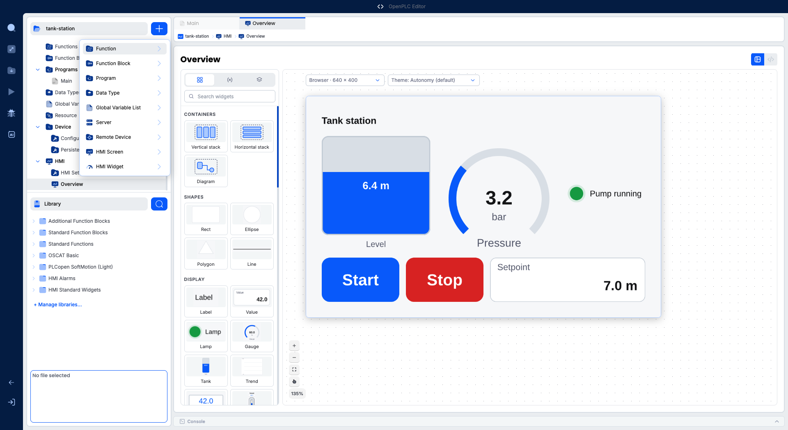
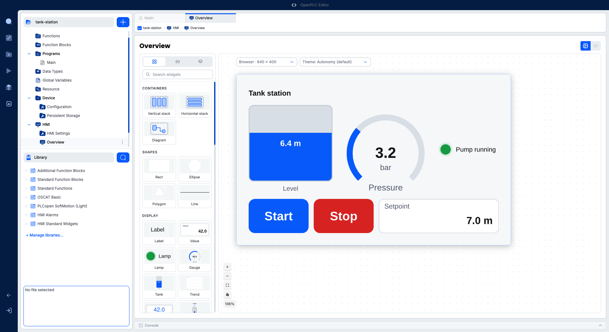
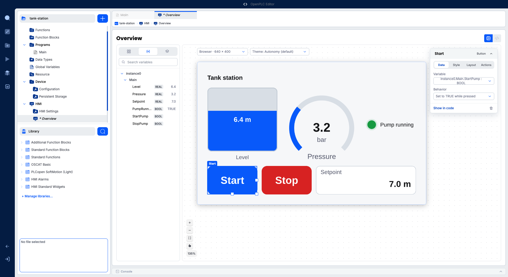
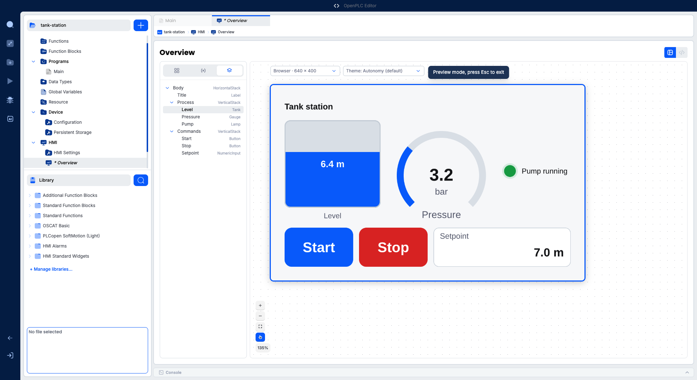
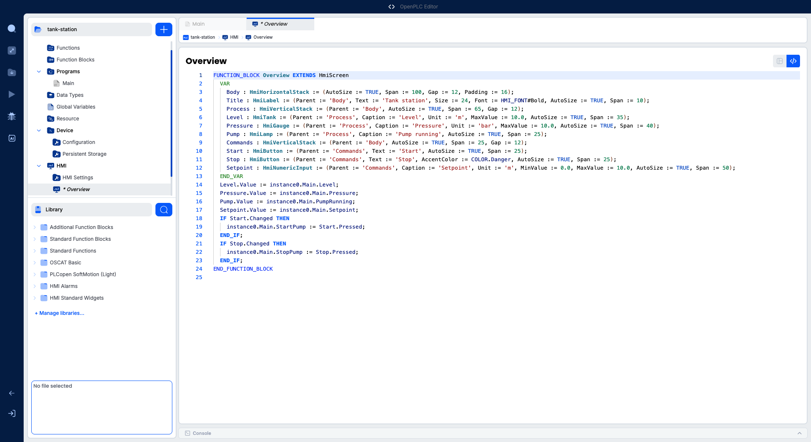

# Designing screens

This page walks through building a screen in the designer, from an empty screen to a working page with live values, buttons and a setpoint.

The examples use a small tank station program:

```st
PROGRAM Main
  VAR
    Level : REAL := 6.4;
    Pressure : REAL := 3.2;
    Setpoint : REAL := 7.0;
    PumpRunning : BOOL := TRUE;
    StartPump : BOOL;
    StopPump : BOOL;
  END_VAR
  IF StartPump THEN PumpRunning := TRUE; END_IF;
  IF StopPump THEN PumpRunning := FALSE; END_IF;
END_PROGRAM
```

---

## Creating a screen

Click the **+** button at the top of the project tree and choose **HMI Screen**. Give the screen a name, such as `Overview`.



The first screen you create also adds **HMI Settings** to the **HMI** branch of the tree. A new screen starts with one container that fills it, ready for widgets.

> **Tip:** Screen names follow the same rules as program names: letters, digits and underscores, starting with a letter.

---

## The designer

The screen opens in the designer:



- **The palette** (left) has three tabs:
  - **Widgets**: everything you can place, grouped (Containers, Shapes, Display, Controls, Process, Alarms, Data), with a search box.
  - **Variables**: the program and global variables you can show.
  - **Layers**: the screen's elements as a tree, which is the easiest way to select a container or a small element.
- **The canvas** (centre) is the screen itself, running. Values, animations and colors are live.
- **The device picker** (above the canvas) sets the display size you preview on: **Browser**, **Browser @1x**, **7" panel**, **ESP32 CYD** or **Phone**.
- **The theme picker** previews the screen in another theme.
- **The zoom controls** (below left) zoom in and out, fit the screen to the window, and switch to preview mode.
- **The properties card** (right) appears when you select an element.

The two buttons at the top right switch between the **Designer** and the **Code** view of the same screen.

---

## Adding widgets

There are two ways to add a widget:

- **Drag** it from the palette onto the canvas. A blue line shows where it lands.
- **Double-click** it in the palette. It goes into the selected container, or at the end of the screen's main container.

Widgets always go into a container. A **Vertical stack** places its widgets side by side, a **Horizontal stack** places them top to bottom, and a **Diagram** places them freely for process graphics. Nest stacks to build rows and columns. See [Screen layout that fits any display](layout).

To move a widget, drag it to another place. To delete it, select it and press **Delete**, or click the bin in its properties card. **Copy**, **Cut** and **Paste** (Ctrl+C, Ctrl+X and Ctrl+V, or Cmd on macOS) copy widgets with everything inside them, and **Undo** and **Redo** work as everywhere else in the editor.

---

## Showing a variable

Open the **Variables** tab, then drag a variable onto a widget. The widget shows that variable from then on.



What dropping a variable does depends on the widget:

| Widget | Dropping a variable |
|---|---|
| Value, lamp, gauge, tank, trend, and other display widgets | Shows the variable. |
| Switch, slider, numeric entry, text entry, drop-down, and other controls | Shows the variable and writes it when the operator changes the control. |
| Button | Writes the variable while the button is pressed. **Behavior** chooses between **Set to TRUE while pressed** and **Set to FALSE while pressed**. |

A widget only accepts a variable of a type it can show. Dropping a REAL on a lamp, for example, is refused with a short message.

You can also pick the variable from the **Variable** field on the **Data** tab of the properties card.

---

## Editing properties

Select an element to open its properties card. The properties are grouped in tabs:

- **Data**: the variable the widget shows, and the values that shape it (minimum, maximum, decimals, units).
- **Style**: colors, captions, fonts and sizes.
- **Layout**: how the element takes its room. See [Screen layout that fits any display](layout).
- **Actions**: what happens when the operator presses it. You can **Show a screen**, **Go back**, **Sign out**, **Lock the panel**, **Calibrate touch**, **Set a variable**, **Toggle a variable**, or write your own **ST code**.

Colors offer the theme's colors (like Accent, Danger or Surface), which follow the screen's theme, or a fixed color of your choice.

**Show in code** at the bottom of the card opens the code view at that element's declaration.

---

## Previewing

The canvas always runs the screen. To operate it the way an operator would, click the hand button under the zoom controls. Presses now reach the widgets instead of selecting them. Press **Esc** to return to designing.



Most edits show at once. Some changes, like editing code, need a new build of the preview: the editor builds it in the background on its own, and the last result stays on screen meanwhile.

> **Tip:** Switch the device picker between the sizes you target before you upload. A screen that reads well on a laptop can be crowded on a 320 by 240 panel.

---

## The code view

Every screen is Structured Text, and the **Code** view shows it. Changes in one view appear in the other.



You rarely need to write screen code, but it is there when you want it: to compute a value, to run logic on a button press, or to navigate between screens. See [Screen code](screen-code).

---

## Next steps

- Make the screen fit every display: [Screen layout that fits any display](layout).
- Choose who may open it: [HMI Settings](hmi-settings).
- Put it on the device: [Running the HMI](running-the-hmi).
