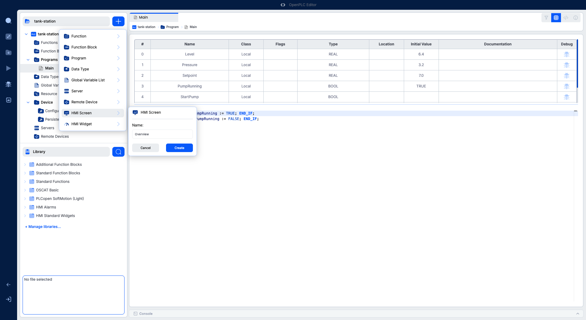
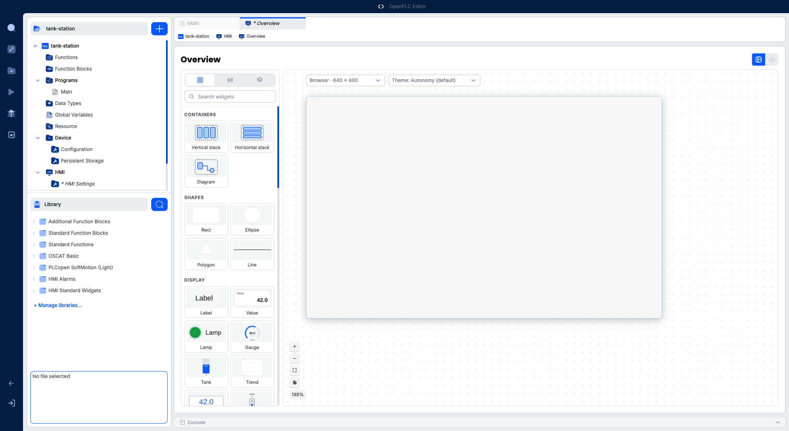
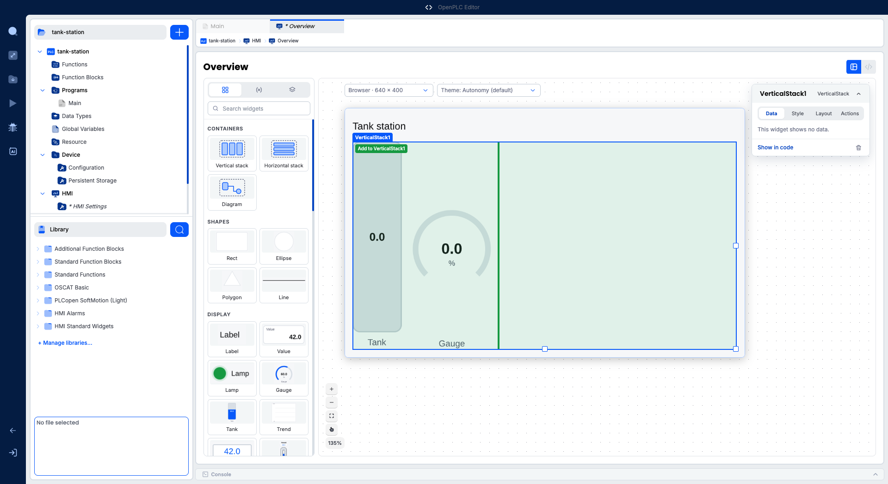
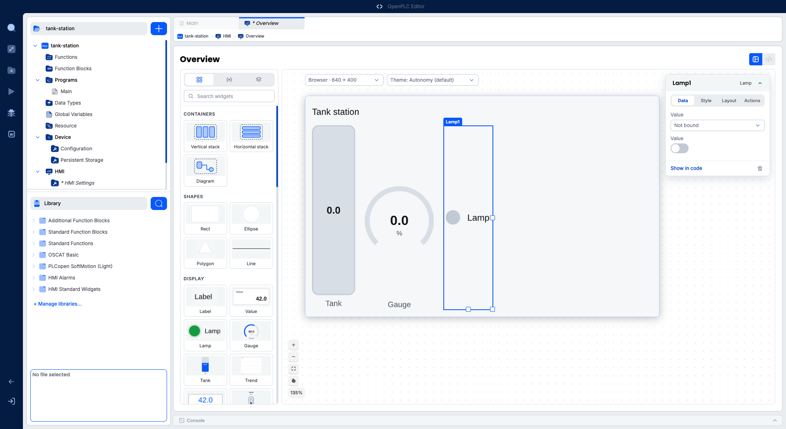
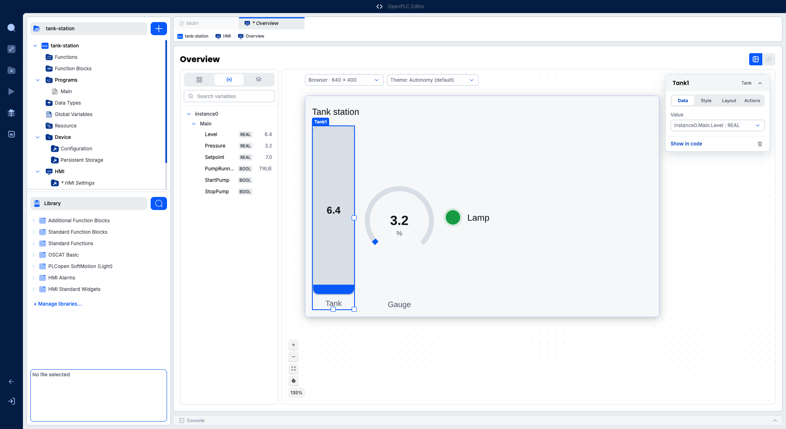
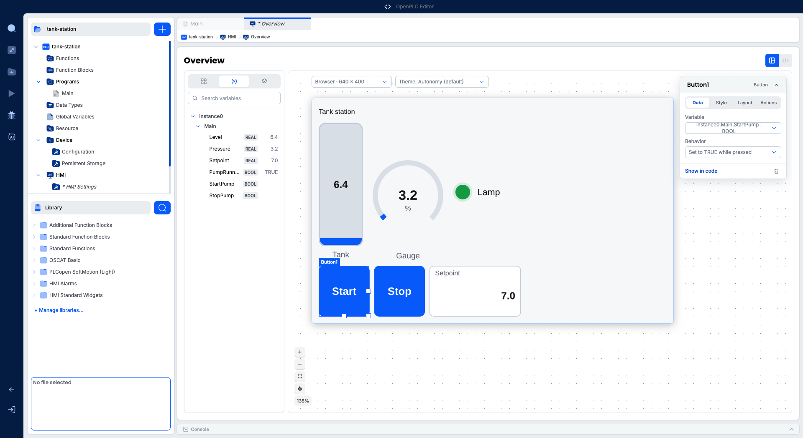
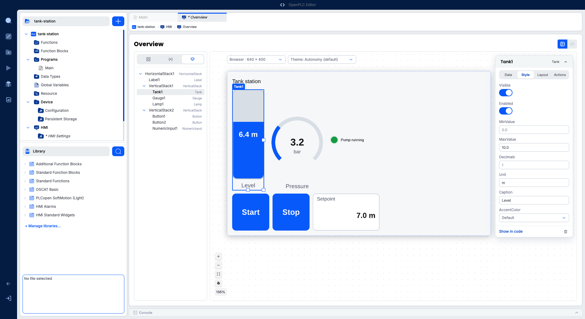
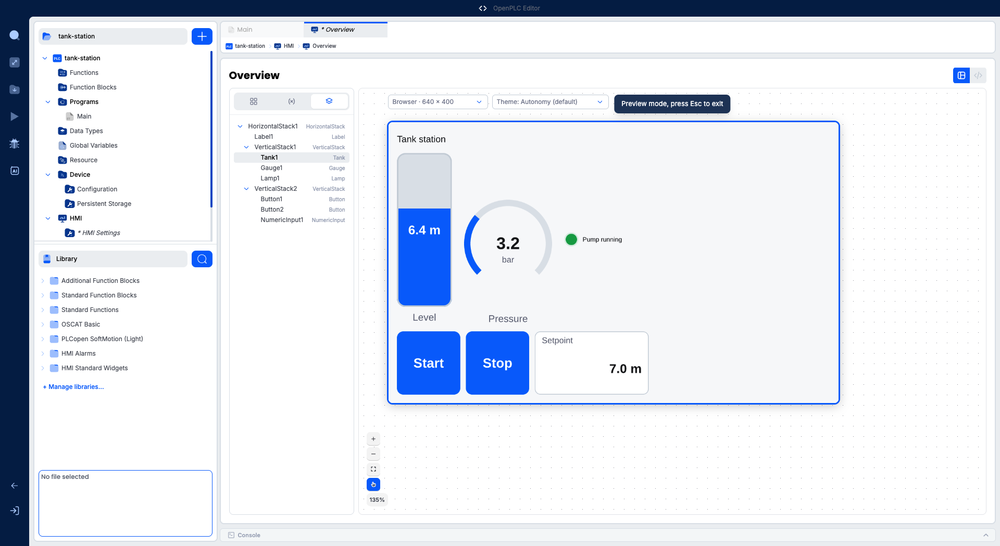
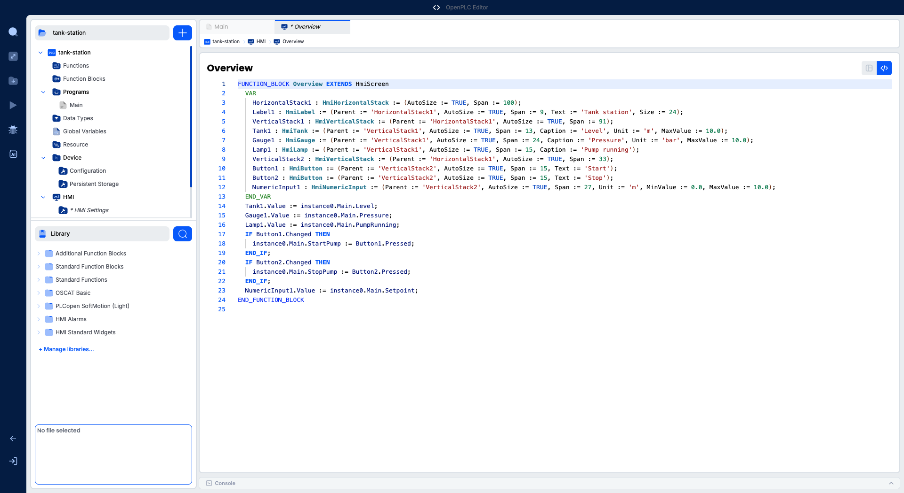

# Designing screens

This page builds a screen from scratch, step by step: an empty screen first, then widgets, then live values, buttons and a setpoint. Follow along in your own project; each screenshot shows the screen at that step.

The screen is for a small tank station. Its program has a tank level, a pressure, a setpoint and a pump that starts and stops:

```st
PROGRAM Main
  VAR
    Level : REAL := 6.4;
    Pressure : REAL := 3.2;
    Setpoint : REAL := 7.0;
    PumpRunning : BOOL := TRUE;
    StartPump : BOOL;
    StopPump : BOOL;
  END_VAR
  IF StartPump THEN PumpRunning := TRUE; END_IF;
  IF StopPump THEN PumpRunning := FALSE; END_IF;
END_PROGRAM
```

---

## Step 1. Create the screen

Click the **+** button at the top of the project tree and choose **HMI Screen**. Type a name, `Overview`, and click **Create**.



> **Tip:** Screen names follow the same rules as program names: letters, digits and underscores, starting with a letter.

---

## Step 2. Meet the designer

The new screen opens in the designer. It is empty except for one container that fills it, ready for widgets. The first screen also adds **HMI Settings** to the new **HMI** branch of the project tree.



- **The palette** (left) has three tabs:
  - **Widgets**: everything you can place, grouped (Containers, Shapes, Display, Controls, Process, Alarms, Data), with a search box.
  - **Variables**: the program and global variables you can show.
  - **Layers**: the screen's elements as a tree, the easiest way to select a container or a small element.
- **The canvas** (centre) is the screen itself, running. Values, animations and colors are live.
- **The device picker** (above the canvas) sets the display size you preview on: **Browser**, **Browser @1x**, **7" panel**, **ESP32 CYD** or **Phone**.
- **The theme picker** previews the screen in another theme.
- **The zoom controls** (below left) zoom in and out, fit the screen to the window, and switch to preview mode.

The two buttons at the top right switch between the **Designer** and the **Code** view of the same screen.

---

## Step 3. Add a title and a row of widgets

Widgets always go into a container. The screen's container is a **Horizontal stack**: it places what you put in it top to bottom. For widgets side by side, add a **Vertical stack** into it. See [Screen layout that fits any display](layout).

There are two ways to add a widget:

- **Double-click** it in the palette. It goes into the selected container (select one on the **Layers** tab), or at the end of the screen.
- **Drag** it onto the canvas. The container it will land in is highlighted, and a line shows where in the container it goes.

For the tank station:

1. Double-click **Label** to add a title. On its properties card (see [Step 6](#step-6-adjust-the-properties)), set its **Text** to `Tank station`.
2. Double-click **Vertical stack** to add a row under the title.
3. Select the row on the **Layers** tab, then double-click **Tank** and **Gauge** to add them to it.
4. Drag a **Lamp** onto the row, after the gauge.



The row now holds a tank, a gauge and a lamp. They show placeholder values for now.



Each widget lands at a sensible size and leaves the rest of the row free for more. To move a widget, drag it to another place. To delete it, select it and press **Delete**, or click the bin on its properties card. **Copy**, **Cut** and **Paste** (Ctrl+C, Ctrl+X and Ctrl+V, or Cmd on macOS) copy widgets with everything inside them, and **Undo** and **Redo** work as everywhere else in the editor.

---

## Step 4. Show the program's variables

Open the **Variables** tab. It lists the program's variables under **instance0** and **Main**, with their types and initial values.

Drag **Level** onto the tank, **Pressure** onto the gauge and **PumpRunning** onto the lamp. Each widget now shows its variable: the tank and the gauge read 6.4 and 3.2, and the lamp turns green.



The tank's fill looks almost empty: the tank still uses its default range of 0 to 100. You fix that in Step 6.

A widget only accepts a variable of a type it can show. Dropping a REAL on a lamp, for example, is refused with a short message. You can also pick the variable from the **Value** field on the **Data** tab of the properties card.

---

## Step 5. Add buttons and a setpoint

Controls show a variable and write it when the operator uses them. Add a second row for them:

1. Select the screen's container on the **Layers** tab and double-click **Vertical stack**.
2. Select the new row and double-click **Button** twice and **Numeric entry** once.
3. Set the buttons' **Text** to `Start` and `Stop`.
4. Drag **StartPump** onto the Start button, **StopPump** onto the Stop button and **Setpoint** onto the numeric entry.



What dropping a variable does depends on the widget:

| Widget | Dropping a variable |
|---|---|
| Value, lamp, gauge, tank, trend, and other display widgets | Shows the variable. |
| Switch, slider, numeric entry, text entry, drop-down, and other controls | Shows the variable and writes it when the operator changes the control. |
| Button | Writes the variable while the button is pressed. **Behavior** chooses between **Set to TRUE while pressed** and **Set to FALSE while pressed**. |

---

## Step 6. Adjust the properties

Select an element to open its properties card. The properties are grouped in tabs:

- **Data**: the variable the widget shows.
- **Style**: captions, units, ranges, colors, fonts and sizes.
- **Layout**: how the element takes its room. See [Screen layout that fits any display](layout).
- **Actions**: what happens when the operator presses it. You can **Show a screen**, **Go back**, **Sign out**, **Lock the panel**, **Calibrate touch**, **Set a variable**, **Toggle a variable**, or write your own **ST code**.

For the tank station, on the **Style** tab:

- Tank: **Caption** `Level`, **Unit** `m`, **MaxValue** `10.0`. The tank now fills to 6.4 of 10.
- Gauge: **Caption** `Pressure`, **Unit** `bar`, **MaxValue** `10.0`.
- Lamp: **Caption** `Pump running`.
- Numeric entry: **Unit** `m`, **MinValue** `0.0`, **MaxValue** `10.0`. Operators cannot enter a setpoint outside these limits.
- Title: **Size** `24`.



Colors offer the theme's colors (like Accent, Danger or Surface), which follow the screen's theme, or a fixed color of your choice. **Show in code** at the bottom of the card opens the code view at that element's declaration.

---

## Step 7. Try it

The canvas always runs the screen. To operate it the way an operator would, click the hand button under the zoom controls. Presses now reach the widgets instead of selecting them: press **Start** and **Stop**, or tap the setpoint to type a value. Press **Esc** to return to designing.



Most edits show at once. Some changes, like editing code, need a new build of the preview: the editor builds it in the background on its own, and the last result stays on screen meanwhile.

> **Tip:** Switch the device picker between the sizes you target before you upload. A screen that reads well on a laptop can be crowded on a 320 by 240 panel.

---

## Step 8. Look at the code

Every screen is Structured Text. Click the **Code** button at the top right to see what the designer wrote for you:



Each element is a declaration with its properties, and the variables you dropped are assignments in the body. Changes in one view appear in the other. You rarely need to write screen code, but it is there when you want it: to compute a value, to run logic on a button press, or to navigate between screens. See [Screen code](screen-code).

---

## Next steps

- Make the screen fit every display: [Screen layout that fits any display](layout).
- Choose who may open it: [HMI Settings](hmi-settings).
- Put it on the device: [Running the HMI](running-the-hmi).
