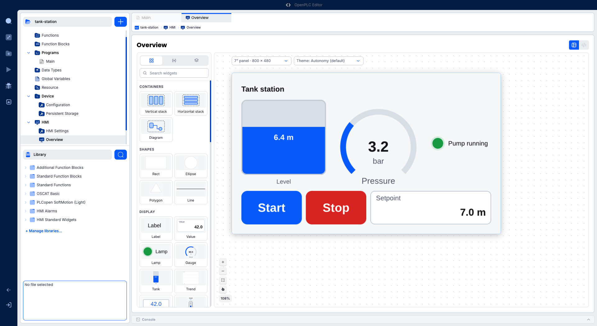
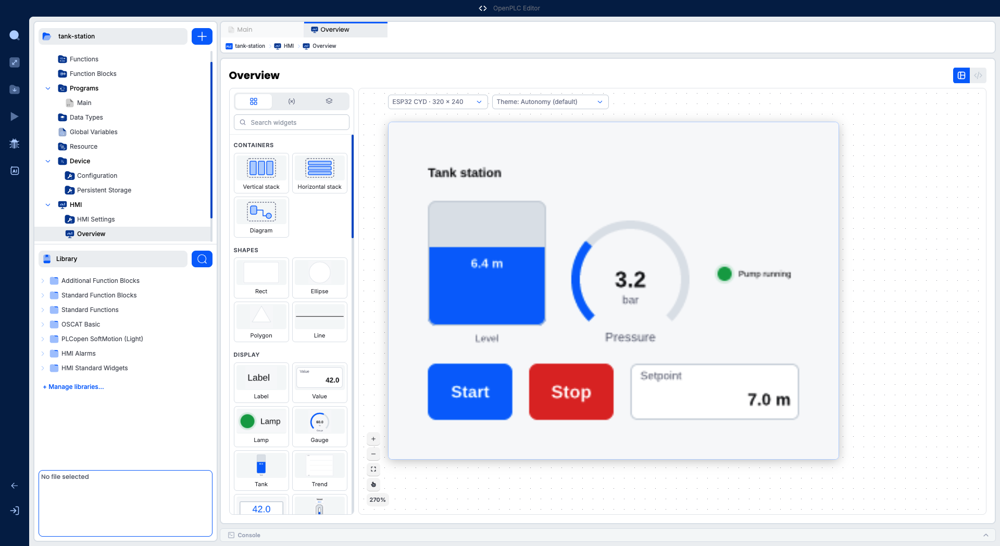
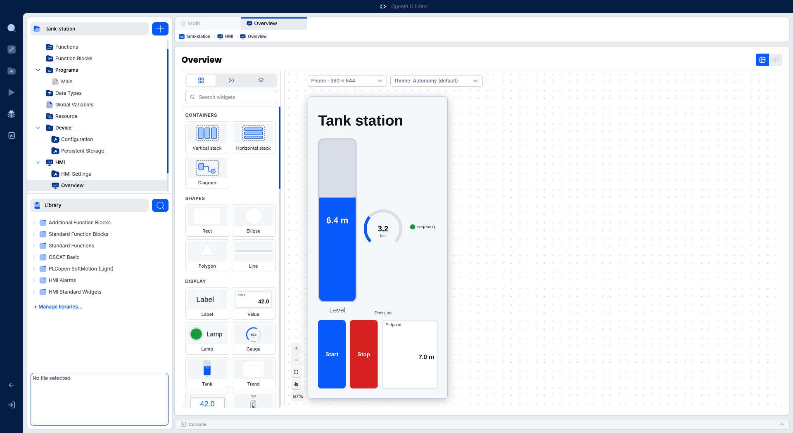

# Screen layout that fits any display

An OpenPLC HMI screen has no fixed size. The same screen runs on a 320 by 240 touch panel, a 7 inch panel, a laptop browser and a control room monitor, and fills each one. You get this by placing widgets in containers and giving each one a share of the room, instead of a position and a size in pixels.

Here is the same Overview screen, unchanged, on three of the editor's preview devices:

---

## Containers

Every widget sits in a container. There are three kinds:

| Container | Places its widgets |
|---|---|
| **Vertical stack** | Side by side, left to right. |
| **Horizontal stack** | Top to bottom. |
| **Diagram** | Freely, at positions you choose, scaled as a whole. For process graphics. |

Stacks nest. The Overview screen above is a horizontal stack (the screen, top to bottom) holding a title, a row for the process widgets and a row for the commands. Each row is a vertical stack.

Only containers sit directly on the screen, so a screen always starts with one: a new screen comes with a horizontal stack that fills it.

A stack also has a **Gap** (the room between its widgets) and a **Padding** (the room around them), on its **Layout** tab.

---

## AutoSize and Span

Each element in a stack has two layout properties that decide its size:

- **AutoSize**: when on, the element is sized by its **Span**. When off, it keeps a size in pixels.
- **Span**: the percentage of the stack's length the element takes.

Along the stack, an element with AutoSize takes its Span of the stack's length. Across the stack, it always fills the whole stack: a widget in a row is as tall as the row.

Spans behave like this:

- **Spans that add up to 100 or less** take exactly their share, and the rest of the stack stays empty. Three widgets at 25 fill three quarters of a row and leave room for more.
- **Spans that add up to more than 100** are scaled down together so the stack is exactly full. Two widgets at 100 each get half.

Because a Span is a share and not a size, the screen keeps its proportions on any display.

> **Tip:** Space between widgets comes from the stack's **Gap** and **Padding**, which are subtracted before the spans are shared out. You do not need spacer widgets.

---

## What the designer sets for you

You rarely type a Span. The designer sets AutoSize and a Span on everything you place in a stack:

- **A widget** you drop gets the Span of its natural size in that stack, so it lands at a sensible size and leaves the rest of the row free.
- **A container** you drop takes whatever room is left in its stack. If the stack is already full, it takes an equal share.
- **A new screen's** container starts at 100.

When a stack has more than 100 in total, the **Span** field shows the share an element really gets, like *shown at 75%*.

---

## Resizing

Select an element and drag its handle. In a stack, dragging changes only the element's **Span**, so the screen stays size independent:

- Drag **along the stack** (the right handle in a row, the bottom handle in a column) to make the element take more or less of the stack. Dragging past the free room takes room from the other elements, in proportion.
- The handle **across the stack** has no effect, because the element always fills the stack in that direction. To make a row taller, resize the row.

Moving an element into another stack keeps its size on screen: the designer works out the Span it needs there.

---

## Fixed sizes

Turn **AutoSize** off when an element must keep an exact size, such as a logo. It then uses **PrefWidth** and **PrefHeight** (or its natural size when they are empty), and its Span is ignored. When a stack is too small for its fixed-size elements, they shrink in proportion.

While AutoSize is on, **PrefWidth** and **PrefHeight** are greyed out: they would have no effect.

Any element can also keep its size within limits with **MinWidth**, **MaxWidth**, **MinHeight** and **MaxHeight**.

> **Warning:** Fixed sizes do not grow on a large display or shrink on a small one. Use them only where an exact size matters more than fitting the screen.

---

## Diagrams

A **Diagram** is for process graphics, where position matters: pumps, valves, tanks and the pipes between them. In a diagram you place symbols at an **X** and **Y** on a grid instead of in a stack. The diagram scales the whole drawing to the room it gets, so it still fits any display, with its proportions kept.

Drag symbols onto the diagram to place them, drag them to move them, and draw a pipe by dragging from one symbol's connection port to another's. Pipes route themselves and can be bent by dragging their corners.

AutoSize and Span have no effect inside a diagram. The diagram itself sits in a stack and is sized by its own Span like any other element.

---

## Designing for several displays

- Check the screen on every device size you target with the device picker above the canvas.
- Think in rows and columns, not in pixels. A row of three gauges stays a row of three gauges on any display.
- Portrait displays (like a phone) are tall and narrow. A row designed for a landscape panel gets narrow there. If you target both, give the phone its own screen with columns instead of rows.

