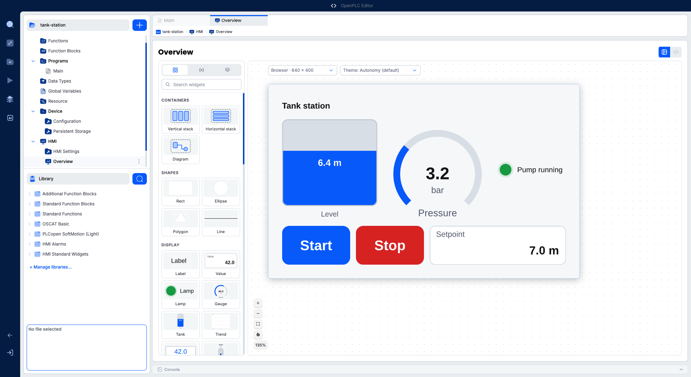

# HMI overview

The OpenPLC Editor lets you build operator screens (an HMI) inside the same project as your PLC program. You design the screens in the editor, the screens read and write the program's variables directly, and the HMI goes to the device together with the program when you upload.

There is no separate HMI tool, no tag database to keep in step, and no screen editor to license. The variables you already declared in the program are the tags.

---

## Where the HMI runs

The same screens run in three places:

| Where | What you see |
|---|---|
| **The editor's preview** | The screen running live while you design it, with your variables' initial values. |
| **A web browser** | On OpenPLC Runtime v4, any browser on the network opens the HMI at the device's address, after signing in. |
| **A local panel** | A board with its own display (such as the ESP32 CYD) draws the screens itself, with touch input. |

The screens look the same in all three. What you see in the preview is what operators see on the device.

---

## The building blocks

An HMI is made of a few kinds of items, all listed under the **HMI** branch of the project tree:

- **Screens.** One page of the HMI, like an overview, a trend page or a settings page. Each screen is a tab you design visually or edit as code.
- **Widgets.** The pieces you place on a screen: labels, values, lamps, gauges, tanks, buttons, switches, entries, trends, process symbols, alarm lists and more. They come from the **HMI Standard Widgets** library, which is installed with the editor.
- **Containers.** Special widgets that hold other widgets and arrange them: stacks and diagrams. Every widget sits in a container.
- **Widget blocks.** Your own widgets, written in Structured Text. Once written, a widget block appears in the palette next to the library widgets.
- **HMI Settings.** Project-wide options: the start screen, themes, which roles may open which screens, and the options of a local panel.

---

## Screens that fit any display

You do not place widgets at fixed pixel positions. You place them in containers and give each one a share of the room (a **Span**). The screen then fits whatever display it runs on: a 7 inch panel, a small 320 by 240 touch screen, a laptop browser or a large control room monitor.

See [Screen layout that fits any display](layout) for how this works.

---

## A typical workflow

1. Write the PLC program and declare the variables you want to show and control.
2. Create a screen from the **+** menu.
3. Drop widgets from the palette into the screen.
4. Drag variables from the **Variables** tab onto the widgets.
5. Check the result in the preview, on the device sizes you target.
6. Decide which roles may open the screen in **HMI Settings**.
7. Build and upload the project. Operators open the HMI in a browser, or on the panel.

---

## In this section

- [Designing screens](designing-screens): the designer, adding widgets, binding variables, the preview.
- [Screen layout that fits any display](layout): stacks, AutoSize and Span.
- [Widget library](widgets): the widgets you can use and what each one shows.
- [Screen code](screen-code): what the designer writes, navigation and actions in Structured Text.
- [HMI Settings](hmi-settings): start screen, themes, roles and local panels.
- [Running the HMI](running-the-hmi): opening the HMI in a browser and on a panel, and the roles that apply.
- [Creating widgets](creating-widgets): writing your own widget blocks.
- [Widget reference](widget-reference): everything a widget block can use.

---

## Third-party software

The HMI includes these open source components:

| Component | Used for | License |
|---|---|---|
| Liberation Sans | The HMI's font, on every display and panel | SIL Open Font License 1.1 |
| stb_truetype | Drawing text from the font | Public domain (or MIT) |
| Socket.IO client | The browser connection to OpenPLC Runtime v4 | MIT |

A firmware build for a local panel places the font's license next to the firmware, in the build folder.
