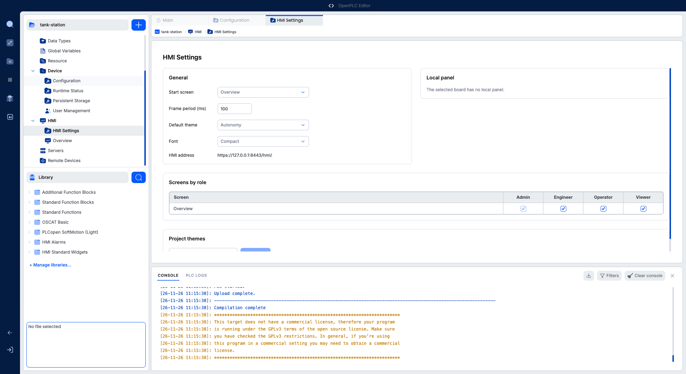
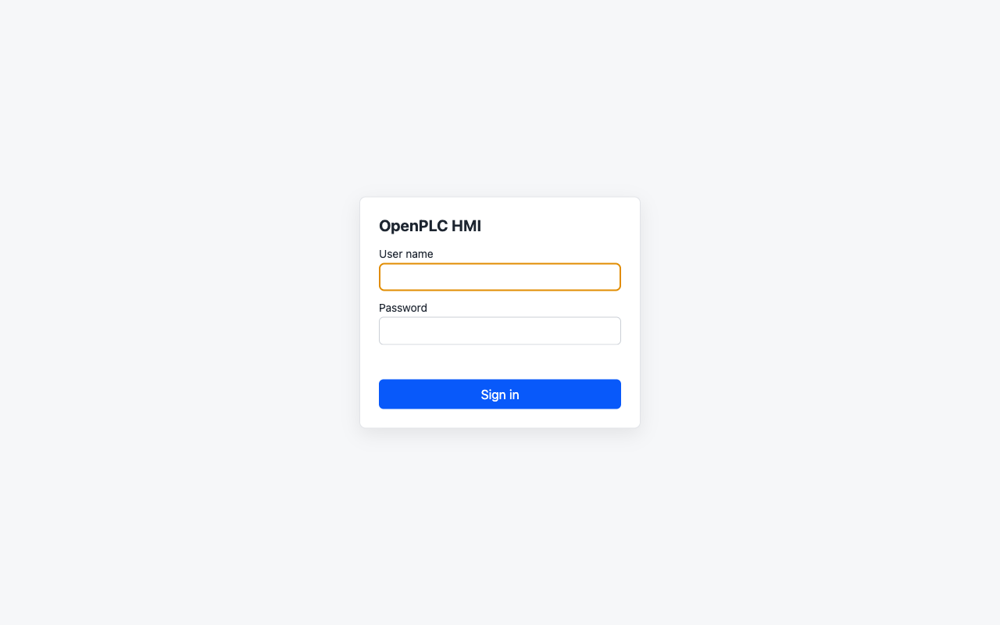
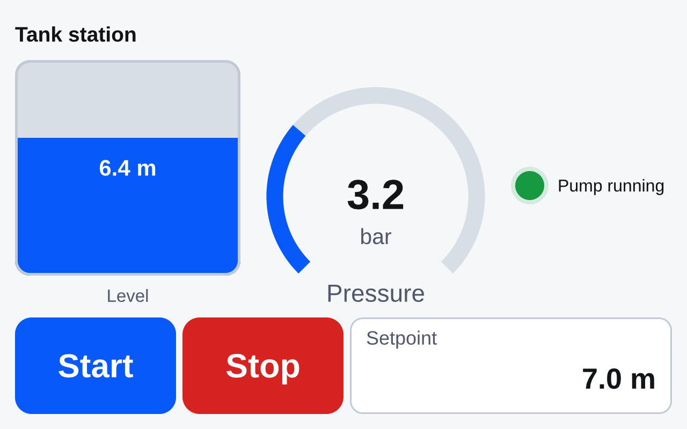

# Running the HMI

The HMI travels with the PLC program. When you build and upload a project that has screens, the screens go to the device too. This page covers opening them in a browser on OpenPLC Runtime v4, and running them on a board with its own display.

---

## On OpenPLC Runtime v4

### Upload

Connect to the device and upload as usual: **Build options**, then **Build and upload**. When the console shows **Upload complete.**, the HMI is on the device.



You need OpenPLC Runtime **4.4.0 or newer**. An older runtime refuses the upload with *This project has HMI screens, but the runtime on this device does not support them.* Update the runtime, or remove the screens to upload the program alone.

Uploading a project without screens removes the HMI from the device.

### Open the HMI

Open a browser on any computer, tablet or phone on the same network, and go to the address shown under **HMI address** in [HMI Settings](hmi-settings):

```
https://<device IP>:8443/hmi/
```

The device uses a self-signed certificate, so the browser warns that the connection is not private the first time. Check that the address is your device's, then continue to the site.

### Sign in

Sign in with an account of the device: the same accounts you use to connect the editor, managed in [User management](../building-deploying/user-management).



The display opens on the **Start screen**, or on the first screen the account's role may open, and stays live:



A display stays signed in for as long as it stays connected, through device restarts. To sign out, give your screens a button with the **Sign out** action. The HMI has no sign out of its own outside the screens.

### Who sees what

What an account sees depends on its role and on the **Screens by role** grid in [HMI Settings](hmi-settings):

| Role | In the HMI |
|---|---|
| **Admin** | Every screen. |
| **Engineer** | Every screen granted to engineers (every new screen, by default). |
| **Operator** | Only the screens granted to operators. |
| **Viewer** | Only the screens granted to viewers. |

On the screens it may open, any role can use the controls those screens offer. Grant viewers screens that only display values when they must not change anything.

Operators and viewers can sign in to the HMI but not upload programs, start or stop the PLC, or debug. See [User management](../building-deploying/user-management).

Every value changed from the HMI is recorded in the device's logs with the account that changed it.

### Messages a display can show

| Message | Meaning |
|---|---|
| **PLC stopped** | The PLC is stopped. The screens return by themselves when it starts. |
| **HMI updating, please wait** | A new program is being installed. The display reloads by itself. |
| **HMI out of date, rebuild the project** | The HMI on the device was built for another program. Build and upload the project again. |
| **No HMI installed** | The device has no screens. Upload a project with screens. |
| **Device busy, try later** | The device has no room for another display right now. The other displays keep working. |
| **Device unreachable, reconnecting** | The network connection was lost. The display reconnects by itself. |
| **Your session expired. Sign in again.** | The display was away longer than a session lasts. |
| **Too many attempts. Try again in ...** | Several wrong passwords in a row. The device makes you wait before the next try. |

### Network security

The HMI shows and changes values of a running machine. Treat it like any other control system access:

- Keep the device and its displays on an isolated control network, not on the internet.
- Give every person their own account, with the lowest role that does the job.
- Use strong passwords: the sign-in page slows down guessing, but does not lock accounts.

---

## On a local panel

Some boards have their own display, such as the ESP32 CYD (a 320 by 240 touch screen). On those, the screens run on the board itself, next to the PLC program. No network or browser is needed.

Build and upload from the **desktop app**, as for any program for the board. The firmware includes the screens and only the fonts they use.

When the board starts it shows the OpenPLC logo for a few seconds, then the PIN entry when the panel requires a PIN, then the start screen. The panel's options (PIN, when it locks again, touch calibration) are in the **Local panel** card of [HMI Settings](hmi-settings).

- The PLC program comes first. The panel draws in the time the program leaves free, so a busy screen updates more slowly instead of delaying the PLC's scans.
- A local panel shows every screen. The role grid applies to Runtime v4 displays only.
- To open the touch calibration at any time, hold a finger on the startup logo for 5 seconds, or use a **Calibrate touch** action on a screen.

> **Warning:** Anyone at the panel can operate it. The PIN is a convenience, not a safety function. Mount the panel where only authorized people can reach it.

> **Tip:** Design for the panel's size with the **ESP32 CYD** device in the designer's device picker. See [Screen layout that fits any display](layout).
