# Widget library

The **HMI Standard Widgets** library comes with the editor and is always available. Its widgets are listed in the palette by group, with a live thumbnail of each. This page shows each one and what it is for.

Every widget takes its colors from the screen's theme, so it looks the same in the editor, in a browser and on a panel. The pictures use the default theme and sample values.

Every widget has a **main** value: the one a variable is wired to when you drop the variable on the widget. It is listed below for each widget.

---

## Containers

| Widget | Use it for |
|---|---|
| **Vertical stack** | Placing widgets side by side. |
| **Horizontal stack** | Placing widgets top to bottom. |
| **Diagram** | Process graphics: symbols at positions on a grid, connected by pipes, scaled as a whole. |

Stacks have no look of their own: they arrange what they hold. See [Screen layout that fits any display](layout).

A diagram with two vessels, a pump and a valve, connected by pipes with flow shown:

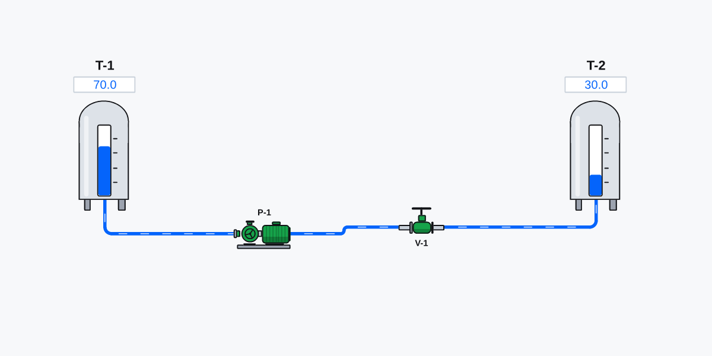

---

## Shapes

Plain shapes for frames, backgrounds, separators and simple graphics. Their colors can follow a variable through screen code.

| Widget | Looks like |
|---|---|
| **Rect** | 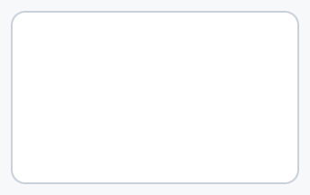 |
| **Ellipse** | 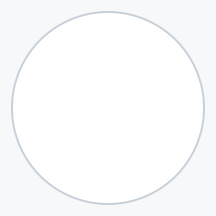 |
| **Polygon** | 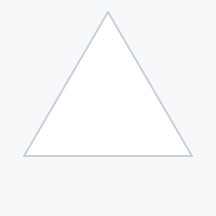 |
| **Line** | 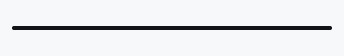 |

---

## Display

| Widget | Shows | Main value | Looks like |
|---|---|---|---|
| **Label** | A text. | Text | 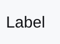 |
| **Value** | A number with caption, unit and decimals. | Value | 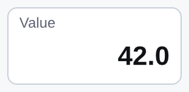 |
| **Readout** | A framed number with a unit, the small readouts of process diagrams. | Value | 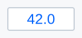 |
| **Lamp** | An on or off state, optionally blinking. | Value (BOOL) | 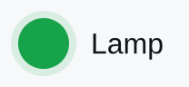 |
| **Multi lamp** | One of several states, each with its own color and text. | Value | 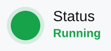 |
| **LED** | A small on or off indicator. | Value (BOOL) | 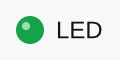 |
| **Gauge** | A value on a round dial, with optional zones. | Value | 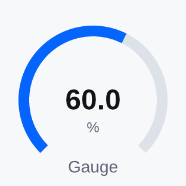 |
| **Tank** | A fill level. | Value | 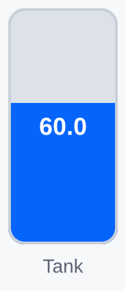 |
| **Vessel** | A vessel symbol with its fill level. | Value | 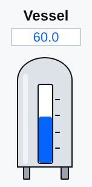 |
| **Thermometer** | A temperature on a thermometer scale. | Value | 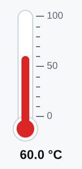 |
| **Bar graph** | One or more values as bars. | Value | 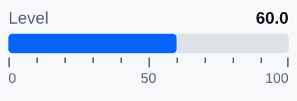 |
| **Progress** | Progress of a task, as a bar. | Value | 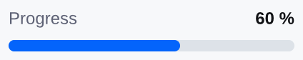 |
| **Seven segment** | A number in seven segment digits. | Value | 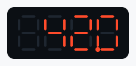 |
| **Trend** | Up to 8 values over time, as pens on a chart. | Value | 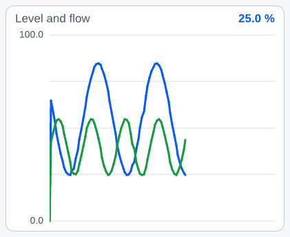 |
| **Date and time** | The date and time of a DT value. | Value (DT) | 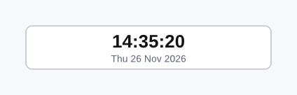 |
| **Clock** | The time of a DT value on an analog clock face, with a second hand. | Value (DT) | 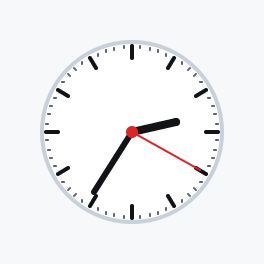 |

---

## Controls

Controls show a variable and write it when the operator uses them.

| Widget | The operator | Main value | Looks like |
|---|---|---|---|
| **Button** | Presses it. The variable is set while it is held. | Pressed | 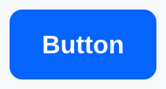 |
| **Toggle button** | Turns something on and off with one button. | Value (BOOL) | 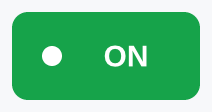 |
| **Lamp button** | Presses a round button that also lights up to show a state. | Value | 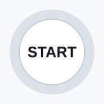 |
| **Switch** | Flips an on and off switch. | Value (BOOL) | 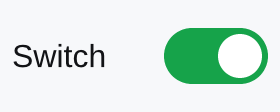 |
| **Check box** | Ticks a box. | Value (BOOL) | 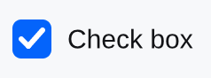 |
| **Slider** | Drags to a value between a minimum and a maximum. | Value | 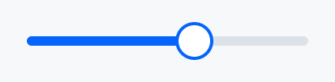 |
| **Knob** | Turns a knob to a value. | Value | 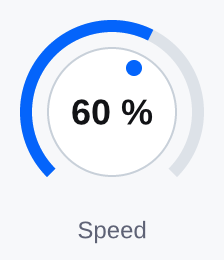 |
| **Stepper** | Steps a value up and down. | Value | 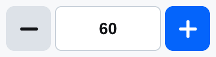 |
| **Numeric entry** | Types a number on an on-screen keypad, within its limits. | Value | 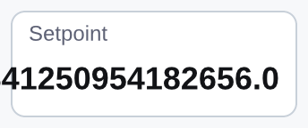 |
| **Text entry** | Types a text on an on-screen keyboard. | Value (STRING) | 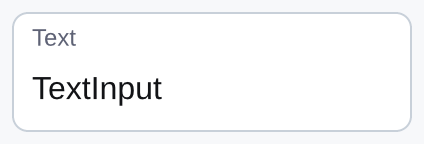 |
| **Selector** | Turns a rotary selector to one of two or three positions. | Value | 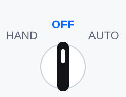 |
| **Option buttons** | Picks one of several options. | Value | 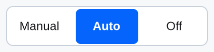 |
| **Drop-down** | Picks one item from a list. | Value | 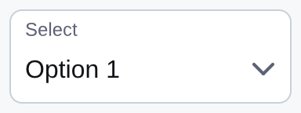 |
| **Dialog** | Confirms an action in a pop-up before it happens. |  | 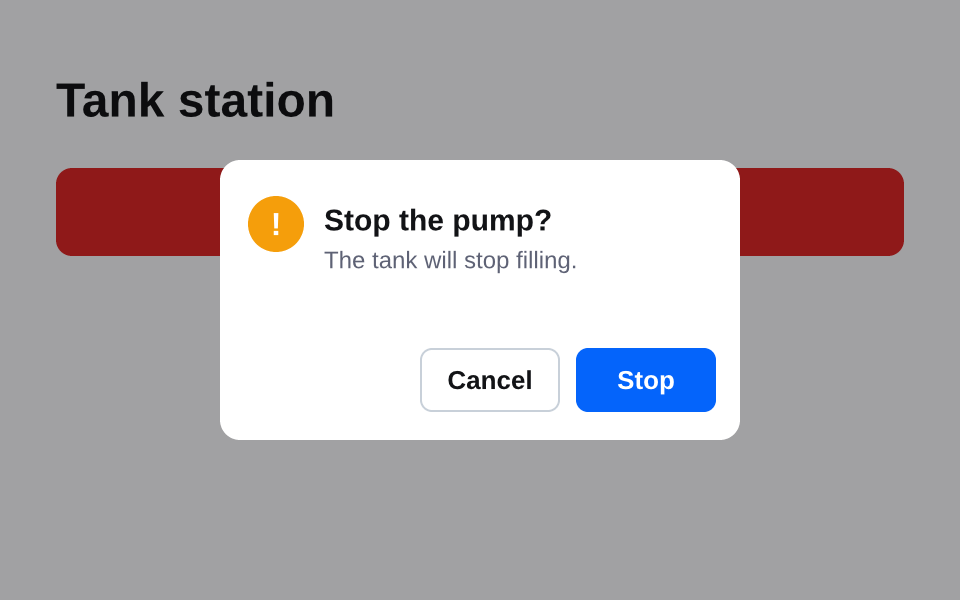 |

> **Tip:** Limits on a numeric entry or a slider are enforced on the device too: a value outside them is refused even if someone tries to send it another way.

---

## Process

Process symbols for P&ID style screens, usually placed in a **Diagram**. Symbols show a running or open state (and, where it applies, a fault) from their main value, with optional animation.

| Widget | Looks like |
|---|---|
| **Pump** | 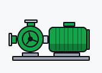 |
| **Fan** | 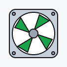 |
| **Motor** | 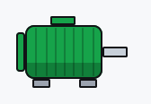 |
| **Agitator** | 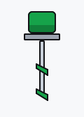 |
| **Conveyor** | 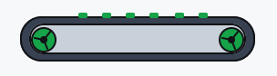 |
| **Valve** | 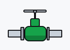 |
| **Control valve** | 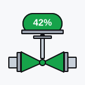 |
| **Check valve** | 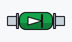 |
| **Three-way valve** | 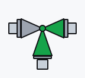 |
| **Heat exchanger** | 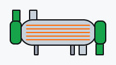 |
| **Silo** | 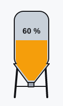 |
| **Instrument** | 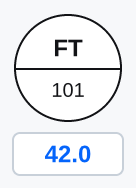 |

A **Pipe** connects two symbols' ports and can show flow, as in the diagram under [Containers](#containers). The **Instrument** shows an ISA style tag bubble with its measured value under it.

---

## Alarms and data

These widgets show tables kept by the PLC program rather than a single value. Instead of dropping a variable, you name the PLC variable in the widget's **Source**.

| Widget | Shows | Source | Looks like |
|---|---|---|---|
| **Alarm banner** | The newest alarm, with an acknowledge button. | An alarm summary. | 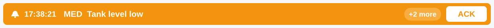 |
| **Alarm list** | All active and unacknowledged alarms, each with its own acknowledge button. | An alarm table. | 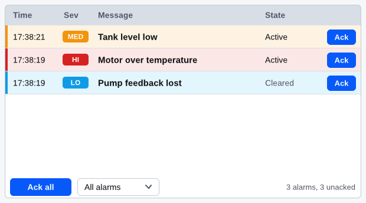 |
| **Event log** | A log of alarms, acknowledgements and events. | An event log. | 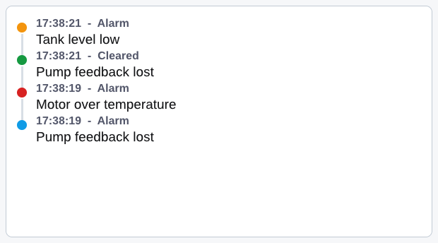 |
| **XY plot** | Points or a curve from two arrays. | Two arrays of REAL. |  |
| **Data table** | Up to 8 tags, each with a description, a live value, a unit and a status color. | None: its values take variables like other widgets. |  |

The alarm table, summary and event log are kept by functions of the **HMI Alarms** library, which is also installed with the editor. Call them every scan in your program:

```st
PROGRAM Main
  VAR
    OverTemp, LowLevel : BOOL;
    Alarms : ARRAY[1..20] OF HMI_ALARM_ROW;
    AlarmSummary : HMI_ALARM_SUMMARY;
    Events : ARRAY[1..100] OF HMI_EVENT_ROW;
  END_VAR
  HMI_ALARM(In := OverTemp, Id := 1, Severity := 3, Message := 'Motor over temperature', Table := Alarms);
  HMI_ALARM(In := LowLevel, Id := 2, Severity := 2, Message := 'Tank level low', Table := Alarms);
  HMI_ALARMS(Summary := AlarmSummary, Table := Alarms);
  HMI_ALARM_LOGGER(Table := Alarms, Events := Events);
END_PROGRAM
```

- **HMI_ALARM** raises an alarm while **In** is TRUE. Severity is 1 (low), 2 (medium) or 3 (high).
- **HMI_ALARMS** applies the acknowledgements operators make on the screens and fills the summary.
- **HMI_ALARM_LOGGER** records raised, acknowledged and cleared alarms in the event log.
- **HMI_LOG_EVENT** adds your own entries to the event log, such as operator actions.

Then set the widgets' **Source** to the variables, for example `instance0.Main.Alarms` for an alarm list and `instance0.Main.AlarmSummary` for an alarm banner.

Size the arrays for your machine: the library sets no limit.

> **Note:** The alarm list and the event log need a target that supports them, such as OpenPLC Runtime v4. On a target without that support they are left out of the palette.

---

## More widgets

Any library you install can add widgets, and you can write your own. A library's widgets appear in the palette under their own groups. To write your own, see [Creating widgets](creating-widgets).
