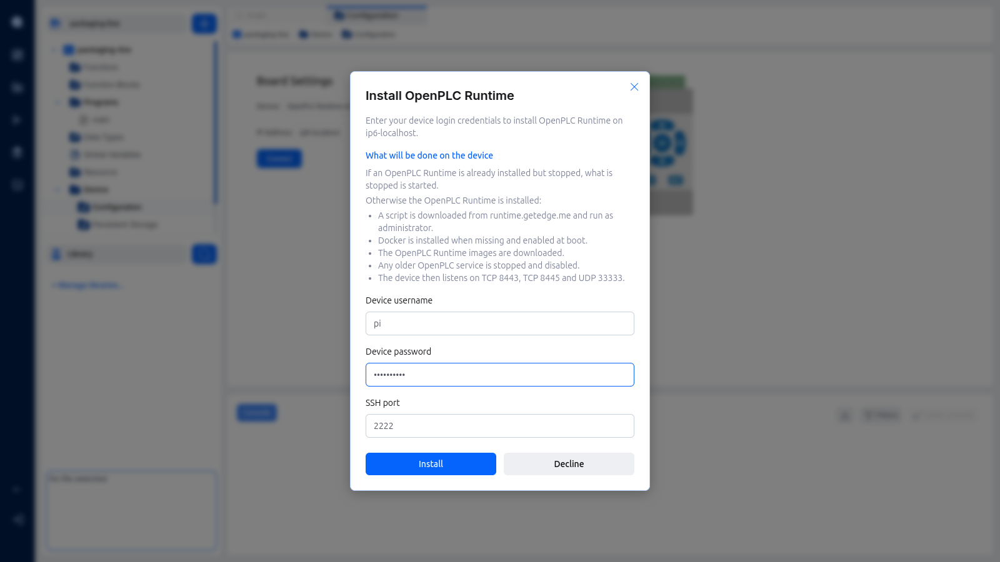
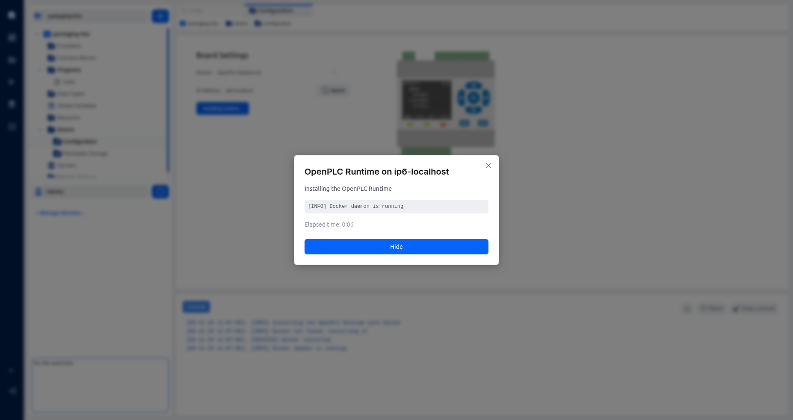
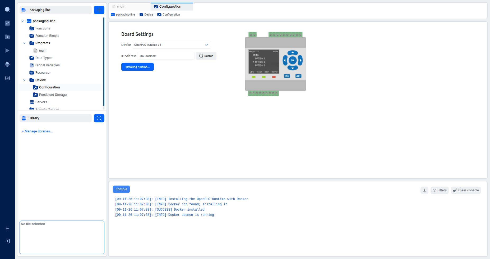
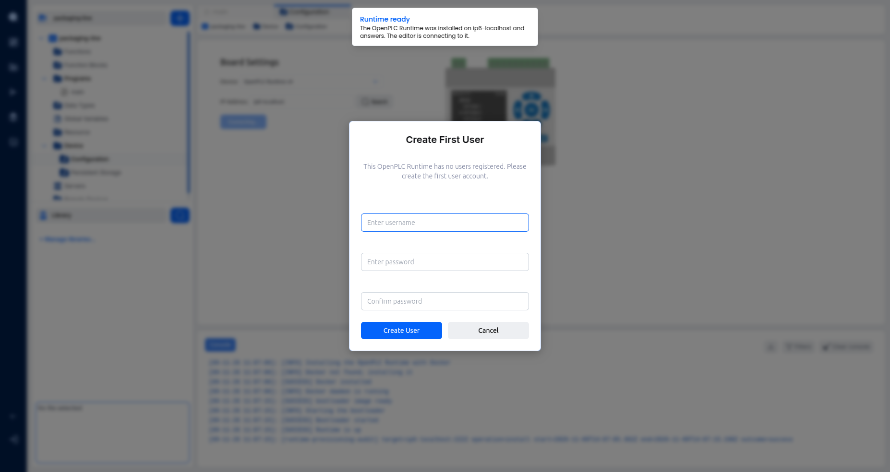
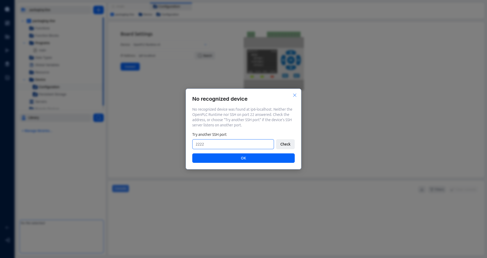

# Installing the Runtime over SSH

When you press **Connect** and no OpenPLC Runtime answers on your device, the editor can log in to the device over SSH and install the runtime there, or start the one that is already installed. You do not need to open a terminal on the device.

> **Note:** This applies to the desktop app only. In the web editor, a device with no running runtime keeps showing the usual **No Response** message.

---

## Before you start

You need:

- A project whose device is **OpenPLC Runtime v4** (or a board based on it), with the device's IP address or host name in the **IP Address** field of **Device** > **Configuration**.
- A Linux device with systemd running, on amd64, arm64, or 32-bit ARM on ARMv7 or newer. ARMv6 boards (for example the first Raspberry Pi models) are not supported.
- SSH with password login enabled on the device.
- An operating-system account of the device that is root, or that can run administrative commands with `sudo` using its own password.
- Internet access on the device, to reach runtime.getedge.me, get.docker.com and ghcr.io.

> **Tip:** On a Raspberry Pi, you can set the username and password and enable SSH with password login in the customisation settings of Raspberry Pi Imager when you write the SD card.

> **Warning:** Make the first SSH connection to a device from a network you trust. On that first connection, the editor trusts the key the device presents, so another host on an untrusted network could pose as the device and receive your password.

---

## Steps

1. In the project tree, expand **Device** and click **Configuration**.
2. Check that the **IP Address** field holds your device's address, then click **Connect**.
3. When the runtime does not answer but the device's SSH server does, the **Install OpenPLC Runtime** dialog opens. It names the device, and its **SSH port** field shows the port that answered.
4. Click **What will be done on the device** to read the list of changes before you agree:
   - If an OpenPLC Runtime is already installed but stopped, it is started.
   - Otherwise the runtime is installed: a script is downloaded from runtime.getedge.me and run as administrator, Docker is installed when missing, the runtime images are downloaded, any older OpenPLC service is stopped and disabled, and the device then listens on TCP 8443, TCP 8445 and UDP 33333.
5. Fill in **Device username** and **Device password** with an account of the device. Change **SSH port** only if the device's SSH server listens on another port.
6. Click **Install**. If the runtime is already installed but stopped, the same button starts it instead. To leave without changing anything, click **Decline**.

The editor logs in, inspects the device and then installs or starts the runtime. While it works, the dialog shows the current step, the latest line written by the installer and the elapsed time. Every installer line also goes to the editor **Console**.

An install can take several minutes, because Docker and the runtime images are downloaded on the device. While the editor is logging in, inspecting the device or downloading the installer, the dialog offers **Cancel**. Once the install or start has begun, it no longer does.

> **Warning:** The username and password are used for this operation only. The editor never saves them and never writes them to the console or to its logs. You type them again for every operation.

---

## Keep working while it runs

Click **Hide** to close the dialog and keep using the editor. The **Connect** button then shows what is running (**Installing runtime...**, **Starting runtime...** or **Preparing runtime...**). Click it to open the dialog again.

Only one operation runs at a time. If an operation that you hid ends without success, the button reads **Show result** until you open the dialog and close it.

---

## Result

When the runtime answers, the dialog closes, a **Runtime ready** notification appears and the usual connection continues:

- After a new install, the runtime has no users yet, so the **Create First User** dialog opens.
- When the runtime already has users (after a start, for example), the **Login** dialog opens.

> **Warning:** Create the first runtime user right after **Runtime ready**. Until that user exists, anyone who can reach the device on the network can create it.

From here, the connection works as described in [Connecting to Runtimes](connecting-to-runtimes).

> **Tip:** Clicking **Yes** on the debugger's **Not Connected** prompt runs the same flow. The debugger does not start on its own afterwards: start it again once the editor is connected.

---

## When the device uses another SSH port

If neither the runtime nor SSH on port 22 answers, the editor shows **No recognized device**. When you know the device's SSH server listens on another port, type it in **Try another SSH port** and click **Check**. If SSH answers there, the install dialog opens with that port.

Otherwise click **OK** and check the address in the **IP Address** field.

---

## Host keys

The first time the editor logs in to a device, it saves the device's SSH host key for that address and port. Every later login to the same address and port must present the same key.

- If the key changed, the editor stops with **Host key changed** before sending your password, and nothing is done on the device.
- The address is matched exactly as you typed it, so an IP address and a host name for the same device count as two devices.

A key changes when the device is reinstalled, for example. Once you have checked that the change is expected, remove the saved key by hand:

1. Close the editor.
2. Open the file `ssh-known-hosts.json` in the editor's user data folder (the folder that also holds the editor's `logs` folder) with a text editor.
3. Delete the entry whose `host` and `port` match the device, and the comma that separated it from its neighbour. Keep the file valid: `"hosts"` stays a list, which may be empty.
4. Save the file and start the editor. The next login trusts the device's new key.

Deleting the whole file makes the editor trust every device again on its next login. If the file is not valid, every operation stops with **Host key file unusable** until you fix or delete it.

---

## Troubleshooting

**Runtime failed to start.**
The runtime is installed on the device but failed to start, and its bootloader is in recovery. The editor changes nothing on the device in this case.

**Bootloader busy.**
The runtime's bootloader on the device reports that it is busy. Try again later.

**Login rejected.**
The username or password is wrong. The dialog asks again within the same operation.

**Password login not accepted.**
The device's SSH server does not allow password login. Enable it on the device, then click **Connect** again.

**No administrative rights.**
The account cannot run administrative commands with `sudo`. Use root or an account that can.

**Unsupported device.**
The operating system, the init system or the architecture of the device is not supported. Nothing was changed.

**OpenPLC Runtime v3 present.**
The device runs OpenPLC Runtime v3. The editor does not install or start the runtime there, and nothing was changed.

**No internet access.**
The device could not download the runtime. Check that the device can reach runtime.getedge.me, get.docker.com and ghcr.io.

**Installer failed** or **Runtime start failed.**
The dialog shows the last lines written on the device, and the editor **Console** holds them too.

**Runtime not started.**
The runtime was installed or started but did not answer within 120 seconds. The dialog shows the last lines written on the device.

**Result unknown.**
The connection to the device was lost, or the installer ran past its time limit, so the editor cannot tell how the operation ended. Click **Connect** again to check the device.

**Operation cancelled.**
You cancelled before the install or start began. Nothing was installed or started.
