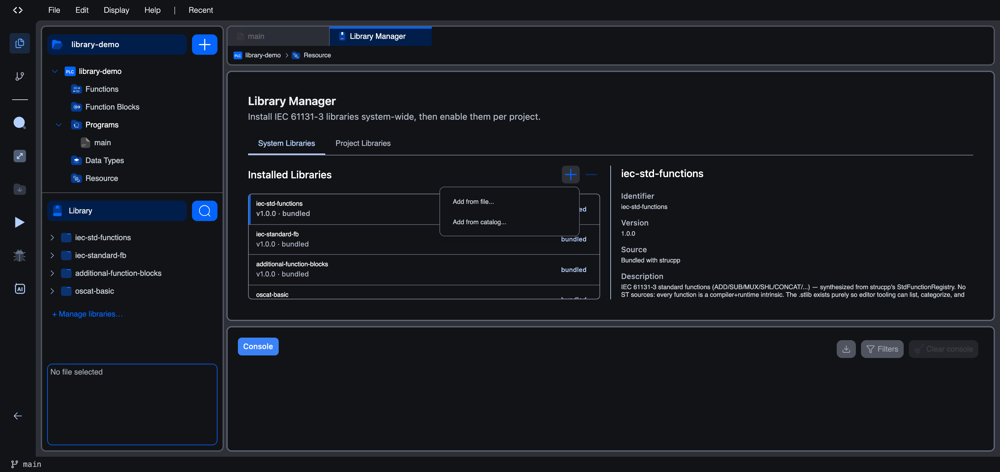
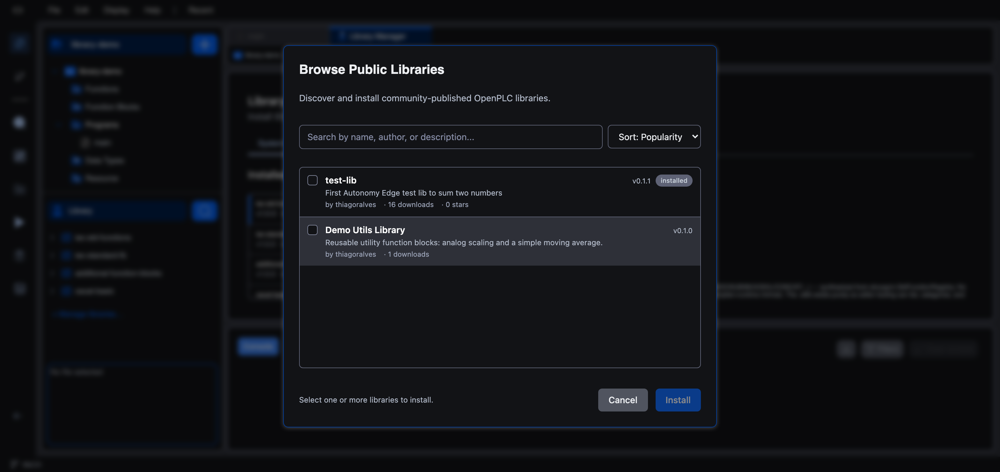
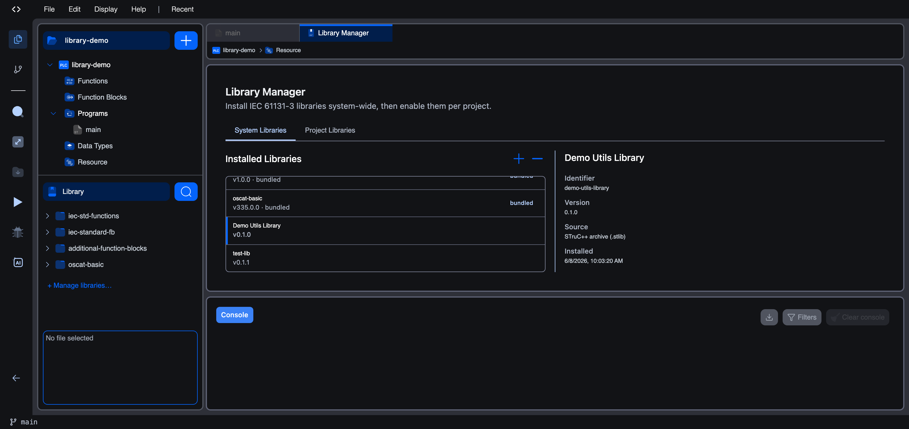
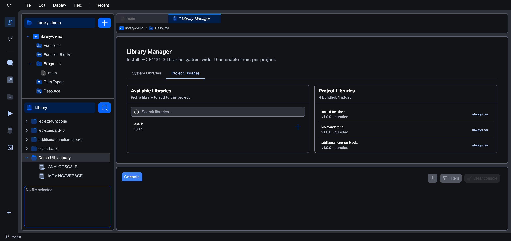
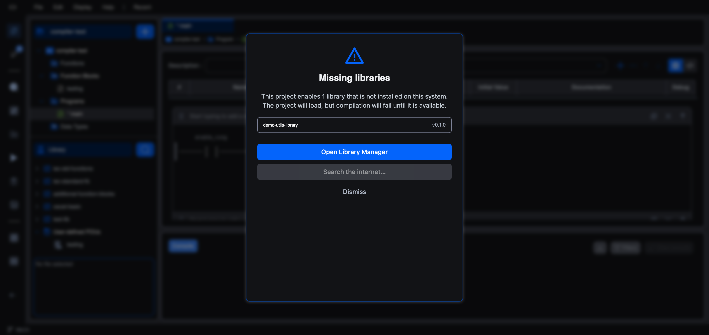
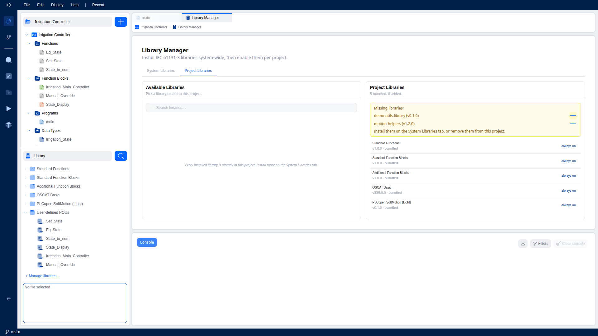
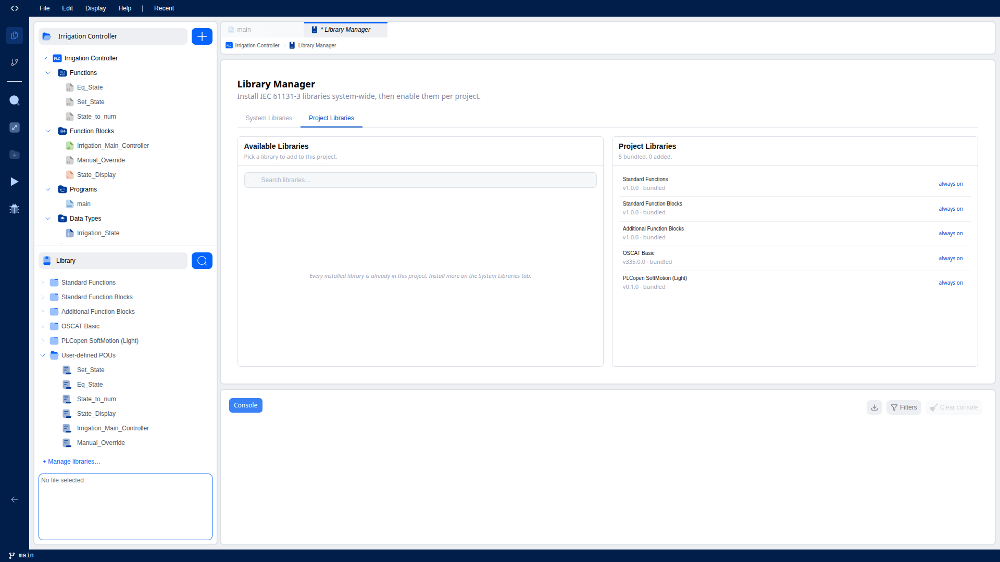

# Installing a Library

Once a library has been [published to the catalogue](publishing-a-library), any project can install it and use its blocks. Installing a library is a **two-step** process that mirrors how the [Library Manager](overview) is organised:

1. **Install it system-wide** so the editor knows about it (the **System Libraries** tab).
2. **Enable it for your project** so its blocks appear in the side panel (the **Project Libraries** tab).

Open the Library Manager from the bottom of the side panel: click **+ Manage libraries…**.

## 1. Install the library system-wide

On the **System Libraries** tab, click the **+** (Add) button above the installed-library list. A small menu offers two sources:



| Source | Use it when |
|--------|-------------|
| **Add from catalog…** | You want a library that has been published to the Autonomy Edge public catalogue. |
| **Add from file…** | You have a `.stlib` archive on disk, for example one you built yourself, or a CoDeSys `.lib` / `.library` to import. |

### Add from catalog

Choosing **Add from catalog…** opens the **Browse Public Libraries** dialog. Search by name, author, or description, sort the results, and tick one or more libraries to install. Libraries already installed are marked with an **Installed** badge:



Tick **Demo Utils Library**, click **Install**, and confirm. When the download finishes, the dialog reports `1 succeeded` and the library appears in the installed list. Selecting it shows its full details (identifier, version, source, and the blocks it contributes):



### Add from file

Choosing **Add from file…** opens a file picker. Select a `.stlib` archive (the native format) or a CoDeSys `.lib` / `.library` package, which the editor converts on import. This is the way to install a library you built yourself but have not published, or one shared with you directly.

## 2. Enable the library for your project

Installing a library system-wide adds it to the editor's pool, but it does **not** automatically switch it on for the project you have open. Switch to the **Project Libraries** tab. Your newly installed library appears under **Available Libraries** on the left. Click its **+** to add it to the project. It moves to **Project Libraries** on the right, and its blocks immediately show up in the **Library** section of the side panel:



With the library enabled, its functions and function blocks are:

- listed in the **Library** section of the side panel,
- available in the variables editor's type picker, and
- drag-and-droppable into Ladder and Function Block Diagram bodies.

### Using the library's global variables

If the library ships [global variables](creating-a-library#sharing-global-variables), your project can read them as soon as the library is enabled. Write the list name, a dot, and the member name, exactly as inside the library:

```iecst
IF Motors.Fault THEN
    speed := 0;
ELSE
    speed := Motors.SpeedSetpoint;
END_IF;
```

You do not declare these variables in your project. They are not listed in the side panel, so type the qualified name where you use it.

> **Warning:** Libraries built with earlier versions of the editor did not include their global variables. If you recreated a library's global variables by hand in your project to work around that, delete those copies once the library has been rebuilt and you have installed the new `.stlib`. If you keep them, the program build fails with a redefinition error on the variable's name.

## The "Missing libraries" prompt

If you open a project that **enables** a library which is **not installed** on your system, for example a project a colleague shared, the editor warns you up front:



The project still opens, but compilation will fail until the library is available. Click **Open Library Manager** to install it (from the catalogue or a file), or **Dismiss** to deal with it later.

### Removing a missing library from the project

If the project no longer needs the library (for example you uninstalled it on purpose), you can remove it from the project instead of installing it.

1. Open the Library Manager (click **Open Library Manager** in the dialog, or **+ Manage libraries…** at the bottom of the side panel) and switch to the **Project Libraries** tab.
2. The **Missing libraries** box lists every library the project enables but your editor does not have, with its version. Click the **−** button next to the library you want to remove.

   

3. The library leaves the list right away. When you remove the last one, the box disappears.

   

4. Save the project.

The project no longer requires the library, so it builds without it, and the **Missing libraries** dialog does not come back the next time you open the project.

> **Warning:** If your program still uses blocks from the removed library, the build reports them as errors. Replace those blocks, or install the library and add it back to the project.

## What's next

- **[Library Manager](overview)**: how system and project libraries fit together.
- **[Creating a Library](creating-a-library)**: author your own library to install elsewhere.
- **[Publishing a Library](publishing-a-library)**: put a library on the public catalogue.
