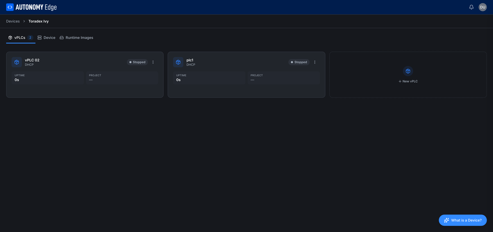
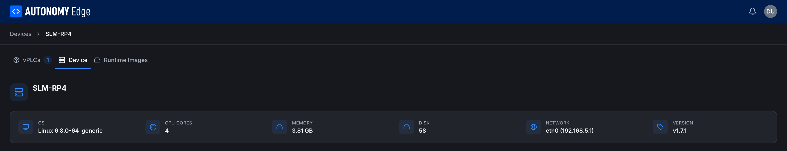
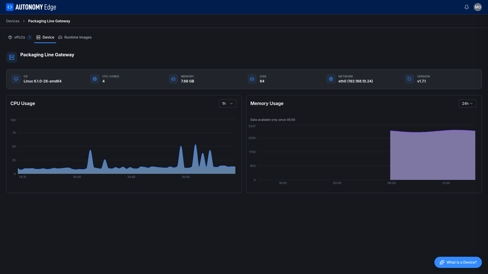
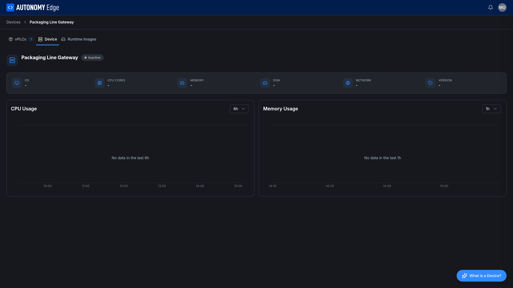

# Device detail

Clicking a Device card from the **[Devices list](devices-list)** opens its detail page. The page has three tabs: **vPLCs** (default), **Device** and **Runtime Images**.

## vPLCs tab

The vPLCs tab is a grid of every vPLC running (or stopped) on this Device, plus a **+ New vPLC** tile to add another.

Each vPLC card shows:

| Element | Description |
|---|---|
| **Icon** | Cube icon, always blue. |
| **Name** | The name you gave when you created the vPLC. |
| **Subtitle** | Network mode (`DHCP` or `Static`). |
| **Status badge** | `Running`, `Stopped`, or `Inactive`. |
| **3-dot menu** | Per-vPLC actions: start, stop, restart, edit, delete. |
| **UPTIME** | How long this vPLC has been up since its last start. |
| **PROJECT** | The project this vPLC is currently running, if any. |

Click anywhere on a card body to open **[vPLC detail](../vplcs/vplc-detail)**.

The **+ New vPLC** tile launches the **[New vPLC wizard](../vplcs/creating-a-vplc)**.

## Device tab

The Device tab is a read-only view of the edge device's specs and current resource usage.

### Header row

- **Device name** and status badge (Inactive / Active).
- Quick stats: **OS**, **CPU CORES**, **MEMORY** (total), **DISK** (total), **NETWORK** (primary interface and IP), **VERSION** (agent version).

These come from the agent's first heartbeat and are refreshed periodically. On an **Inactive** Device they show `-` because no data has been reported yet.

### CPU Usage chart

The chart shows CPU utilization over a time window you choose. The dropdown at the top right of the chart (`1h` by default) sets the window: **1h**, **6h**, **12h** or **24h**.

The time axis always spans the whole window you selected, up to the latest sample the Device reported. Its labels fall on round times of day in your local time zone, for example 14:15, 14:30, 14:45 on the 1h window, or 18:00, 00:00, 06:00, 12:00 on the 24h window. When the Device has data for only part of the window, the line covers only that part and the rest of the window stays empty.

### Memory Usage chart

Same controls and behavior as the CPU chart, for memory.

Each chart has its own dropdown, so you can show CPU over the last hour and memory over the last day at the same time. Each chart keeps its window when you switch to another tab and come back.

### When a chart has no data or only part of it

A chart tells you when it cannot fill the window you selected, instead of showing a different window:

| Message | What it means |
|---|---|
| **No data in the last 6h** (with the window you selected) | The Device reported no sample in that window. This is what you see on an **Inactive** Device. |
| **Data available only since 05:50** (with the time of the oldest sample) | The Device has data for only part of the window, starting at that time. This is usual shortly after the Device or its agent restarted, because the usage history starts again at the restart. |
| **Loading the last 24h** (with the window you just selected) | The data of the new window is still on its way. The chart draws it as soon as it arrives, and the other chart keeps showing its own data meanwhile. |

These charts come from the periodic heartbeat the agent sends. If the agent is alive but the chart is flat, check that the **VERSION** matches the latest release, older agent versions may not stream as many metrics as newer ones.

## Runtime Images tab

The Runtime Images tab manages the OpenPLC runtime images cached on this Device. A vPLC can only be created from an image that is already here (see **[Creating a vPLC](../vplcs/creating-a-vplc)**).

- **Download a runtime image**: pick a version from the dropdown and click **Download**. This needs the Device to be online.
- **Or import from a file**: upload a runtime image archive (`.tar`, `.tar.gz` or `.tgz`) produced with `docker save ghcr.io/autonomy-logic/openplc-runtime:vVERSION -o runtime.tar`, replacing `VERSION` with the version you want, for example `v4.2.2`.
- The list below shows every image cached on the Device, with its version, size and date, and a trash icon to remove it when you have permission to.

## Switching tabs

The tabs are sticky inside the Device detail page. Refreshing the page keeps you on the same tab thanks to the URL.

## Breadcrumb

At the top of the page, a breadcrumb shows **Devices → {Device name}** so you can jump back to the **[list](devices-list)** with one click.

## Where to next

- **Add or manage vPLCs** → **[Creating a vPLC](../vplcs/creating-a-vplc)**, **[vPLC detail](../vplcs/vplc-detail)**.
- **Rename / delete / re-pair** → **[Managing devices](managing-devices)**.
- **Inspect vPLC-level network info** → **[Network modes](../vplcs/network-modes)**.
